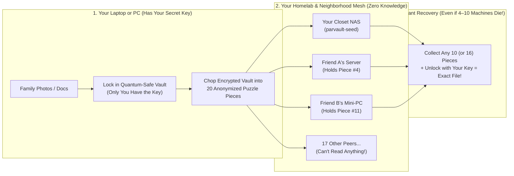

# Neighborhood Cloud (`parvault` & `parvault-seed`) — Homelab & Everyday User Quickstart Guide

> **No CS or math degree required.** If you know how to run a command in a terminal (or spin up a Docker container / Raspberry Pi), this guide will get your files backed up with **zero monthly cloud bills** and **zero trust** in anyone else's computer.

---

## 1. What Is This? (The 60-Second Plain-English Version)

### Why Traditional Backups Fall Short
Every homelabber and self-hoster eventually hits the same painful choice:
1. **Big Tech Cloud Storage:** Charges you every single month forever, throttles your uploads, and holds the keys to scan, lock, or leak your private files.
2. **A Single NAS or USB Drive in Your Closet:** Costs \$0/month, **until** your house has a pipe burst, a fire, a burglary, a lightning strike, or a ransomware attack—and takes both your computer and your backup drive with it.

### How Neighborhood Cloud Fixes This (`BitTorrent` + `Syncthing` + `A Quantum-Safe Puzzle Box`)
Neighborhood Cloud lets your computers, your home server, and your friends' or neighbors' home servers team up to back each other up automatically—**without anyone ever being able to see anyone else's files:**

1. **Step 1 — Locked in a Quantum-Safe Vault Before It Leaves Your Machine:**
   Before a photo or document ever touches your network card, `parvault` pads its size (so nobody can even guess what kind of file it is) and locks it inside a **dual-layer, post-quantum encrypted vault** (`AES-256-GCM` + NIST post-quantum `ML-KEM-768` / `ML-DSA-65`). Your secret **Master Key** never leaves your computer.
2. **Step 2 — Chopped into 20 "Space-Probe" Puzzle Pieces ("Shards"):**
   Using **Reed-Solomon erasure coding** (the exact same math NASA uses to talk to deep-space probes across the solar system), that locked vault is split into **20 puzzle pieces** and spread across different machines.
   - **Here's the magic:** You **don't** need all 20 pieces to get your file back!
   - In standard **Consumer Mode (`10-of-20`)**, **any 10 pieces** out of 20 reconstruct your entire file—meaning **half the network (10 computers!) can explode at the same time** and you lose **zero bytes**.
   - Once your 24/7 home server proves it stays online, it automatically unlocks **Homelab Mode (`16-of-20`)**, where **any 16 pieces** reconstruct your file using only **1.25x** total storage space (`80%` efficiency) instead of making 2x or 3x full copies!
3. **Step 3 — Completely Anonymized ("Blinded") Puzzle Pieces:**
   Every puzzle piece is given a random disguise ("blinded locator") and passed through a neighbor relay. The computers holding your puzzle pieces have **zero idea** what the file is, whose computer sent it, or which other puzzle pieces belong to the same file.



---

## 2. Which Binary Should I Run? (`parvault` vs. `parvault-seed`)

Neighborhood Cloud builds **two small, self-contained binaries** so you never have to install heavy software on a headless server:

| Binary | Who Should Run It? | What Does It Do? | Can It Read My Files? |
| :--- | :--- | :--- | :---: |
| **`parvault`**<br>*(The Everyday Backup & Sync App)* | **Your personal computers** (laptop, gaming PC, desktop workstation, or a server whose own folders you want to back up). | Encrypts your files, watches folders for changes (`watch-folder`), previews diffs (`diff-folder`), restores backups (`restore-folder`), and trades encrypted puzzle pieces. | **Yes** (on *your* machine, because it holds your secret Master Key). |
| **`parvault-seed`**<br>*(The Dedicated Zero-Trust Backup & Bootstrap Server)* | **Always-on headless hardware** with spare disk space: a Raspberry Pi, an Unraid/TrueNAS box in your closet, an old mini-PC, or a cheap VPS. | Holds anonymized, encrypted puzzle pieces (`--mode homelab-vault` or `--mode public-bootstrap`), answers uptime health checks, and earns **High-Uptime Homelab status** for you. | **NO — Never.** It holds **zero decryption keys** and only ever sees random-looking puzzle pieces. |

---

## 3. Five Step-by-Step Copy-Paste Recipes

### Step 1: Inspect Your Node Identity (`parvault identity`)
Before linking your laptop and your NAS, run `parvault identity` to view your machine's unique **`Device Peer ID`** and your **`Owner PQ Public Key Hex`**:

```bash
# View (or automatically create) your persistent node identity and post-quantum owner key
parvault identity
```

You will see output like:
```text
=== ParVault Node & Post-Quantum Identity ===
Data Directory          : .parvault-data
Device Peer ID          : parvault-peer-8f3a9c12e4b07d11
Ed25519 Public Key (hex): 8f3a9c12e4b07d11...
Owner PQ Public Key Hex : 20000000... (copy this for your NAS!)
Master Key Fingerprint  : sha256:4b19e8f021a7c6d4
```

---

### Step 2: Link Your Laptop & Closet NAS for Unlimited Free Self-Backup (`issue-device-cert` & `verify-device-cert`)
Because you own both your laptop and your home server (`parvault-seed`), you don't need to pay reciprocity storage quota to back up to yourself! Issue a post-quantum **Personal Device Certificate** (`PARVAULT-CERT-V1:...`) using your `Device Peer ID` from Step 1:

```bash
# 1. On your laptop: Issue a certificate for your Device Peer ID (saves JSON + prints a PARVAULT-CERT-V1: token)
parvault issue-device-cert \
  --device-peer-id "parvault-peer-8f3a9c12e4b07d11" \
  --device-label "My-Laptop" \
  --cert-out ./my-laptop.device-cert.json

# 2. On your NAS: Verify the certificate using either the .json file OR the copy-pasteable PARVAULT-CERT-V1:... token
parvault-seed verify-device-cert \
  --data-dir /mnt/nas/parvault-seed \
  --cert ./my-laptop.device-cert.json \
  --owner-pq-pubkey-hex "<YOUR_OWNER_PQ_PUBKEY_HEX_FROM_STEP_1>"

# 3. Start your 24/7 NAS vault server locked to your Owner PQ Public Key
parvault-seed start \
  --mode homelab-vault \
  --data-dir /mnt/nas/parvault-seed \
  --max-gb 500 \
  --owner-pq-pubkey-hex "<YOUR_OWNER_PQ_PUBKEY_HEX_FROM_STEP_1>" \
  --listen /ip4/0.0.0.0/tcp/4002
```

- **On Day 1 (even with 0 friends connected):** Your laptop, desktop, and `parvault-seed` NAS immediately form a **`2-of-3` Personal Device Ring** with **unlimited self-quota (`0.00x` tax)**.
- **As your `parvault-seed` NAS stays online 24/7:** It automatically passes background Proof-of-Retrievability (PoR) health checks and earns **`HighUptimeAnchor`** status—unlocking the **`16-of-20` Homelab Tier (`80%` storage efficiency)** and a **`5.0x` storage quota multiplier** across the neighborhood mesh!

---

### Step 3: Filter Junk with `.parvaultignore`, Preview with `diff-folder`, and Sync with `watch-folder`
By default, `parvault` automatically ignores noisy junk folders (`.git`, `node_modules`, `target`, `.DS_Store`, `Thumbs.db`, `*.tmp`, `*.swp`). You can also drop a **`.parvaultignore`** file inside any folder you back up:

```bash
# 1. Create a folder with an important file and a .parvaultignore rule
mkdir -p ./my-photos
echo "Irreplaceable family memories and homelab configs" > ./my-photos/notes.txt
echo "*.iso" > ./my-photos/.parvaultignore

# 2. Preview what will be backed up (dry-run diff without writing any shards yet)
parvault diff-folder --folder ./my-photos

# 3. Encrypt, chop into puzzle pieces, and save a signed snapshot manifest (--once runs a single pass)
parvault watch-folder \
  --folder ./my-photos \
  --snapshot-out ./my-photos.manifest.bin \
  --prune-deleted \
  --once
```

Want `parvault` to continuously watch `./my-photos` in the background every 5 seconds? Just omit `--once`:
```bash
parvault watch-folder \
  --folder ./my-photos \
  --snapshot-out ./my-photos.manifest.bin \
  --interval-secs 5
```

---

### Step 4: Restore One File, a Whole Folder, or Recover After a House Fire (`restore-folder` & `recover-from-seed`)

**Option A — Restore a Single Accidentally Deleted File (`--file`):**
```bash
parvault restore-folder \
  --snapshot ./my-photos.manifest.bin \
  --out-dir ./restored-single \
  --file "notes.txt"
```

**Option B — Restore the Entire Folder Tree:**
```bash
parvault restore-folder \
  --snapshot ./my-photos.manifest.bin \
  --out-dir ./restored-photos
```

**Option C — Zero-Local-State "House Fire" Recovery (12- or 24-Word BIP-39 Recovery Phrase):**
What if your house burns down and destroys your laptop **and** your local `.manifest.bin` / `master_key.sealed` files?
When backing up, pass `--seed-phrase` (supports standard 12-word or 24-word checksummed BIP-39 mnemonics) and `--catalog-out`:
```bash
# Back up with a deterministic BIP-39 recovery phrase and export an encrypted root catalog
parvault watch-folder \
  --folder ./my-photos \
  --snapshot-out ./my-photos.manifest.bin \
  --seed-phrase "abandon abandon abandon abandon abandon abandon abandon abandon abandon abandon abandon about" \
  --vault-namespace "family-photos" \
  --catalog-out ./my-photos.catalog.bin \
  --once

# On a brand-new laptop after a disaster: recover everything from your seed phrase + encrypted catalog!
parvault recover-from-seed \
  --seed-phrase "abandon abandon abandon abandon abandon abandon abandon abandon abandon abandon abandon about" \
  --vault-namespace "family-photos" \
  --catalog-envelope ./my-photos.catalog.bin \
  --out-dir ./recovered-after-fire
```

**Option D — Laptop "Lite Client" Mode + NAS-Death Mesh Failover & Selective Partial Restore (`--lite-seed-dir` & `--filter`):**
If you have a laptop and a home NAS/Raspberry Pi running `parvault-seed`, your laptop can run in **Lite Client Mode**:
- Your laptop encrypts files locally (`K_user` never leaves your laptop) and sends `1.0x` encrypted ciphertext to your `parvault-seed` box.
- Your `parvault-seed` box caches the shards for fast **"Cloud Away From Home"** access AND syndicates `16-of-20` Reed-Solomon shards to the Neighborhood Cloud mesh on your behalf.
- **If your NAS dies**, your laptop speaks the exact same protocol and automatically fails over to recovering directly from the Neighborhood Cloud mesh — and with `--filter`, you can restore **only the specific folders or files you need on your laptop** without downloading your entire multi-terabyte NAS vault!

```bash
# 1. Back up from your laptop in Lite-Client mode via your paired Seed Box over libp2p
parvault --peers "/ip4/10.42.1.11/tcp/4001,/ip4/10.42.1.12/tcp/4001" watch-folder \
  --folder ./work-projects \
  --snapshot-out ./work.manifest.bin \
  --lite-seed-dir /ip4/10.42.1.10/tcp/4002 \
  --device-cert ./my-laptop.device-cert.json \
  --once

# 2. Browse everything inside a snapshot with ZERO shard downloads
parvault list-snapshot --snapshot ./work.manifest.bin

# 3. Selective Partial Restore: restore ONLY the urgent files/folders your laptop needs!
parvault restore-folder \
  --snapshot ./work.manifest.bin \
  --out-dir ./restored-urgent-docs \
  --filter "contracts/*,tax-2026.pdf"
```

---

### Step 5: Check Your Earned Standing (`status`) & Scrub for Disk Bit-Rot (`scrub`)

Check your node's storage quota, minimum free disk reserve, and **Earned Uptime Standing** at any time, or run the built-in bit-rot scrubber to verify every shard on your hard drive:

```bash
# Inspect your node configuration, storage quota, and Earned Standing ladder
parvault status
parvault-seed status --data-dir /mnt/nas/parvault-seed

# Proactively verify every local .shard and .bshard file against silent disk bit-rot
parvault scrub
parvault-seed scrub --data-dir /mnt/nas/parvault-seed

# Gracefully exit the network and automatically redistribute hosted shards to mesh peers at 1.0x bandwidth
parvault leave
parvault-seed leave --data-dir /mnt/nas/parvault-seed
```

---

## 4. How the Automatic "Trust & Storage Ladder" Works

Your node automatically climbs the **Earned Uptime Ladder** based on how many peers are around and how reliably your machine stays online:

| Stage | Who Is Connected? | Puzzle Pieces (`K-of-N`) | How Many Machines Can Die at Once? | Storage Space Needed per `100 GB` Backed Up |
| :--- | :--- | :---: | :---: | :---: |
| **1. Personal Ring** | Just your own devices (`PersonalDeviceCert`) | **`2-of-3`** | **1 of 3** machines can die | **Free (`0 GB` external quota)** |
| **2. Buddy Co-Op** | **1 to 5** friends' homelabs | **`3-of-5`** | **2 of 5** machines can die | **`167 GB`** (`60%` efficiency) |
| **3. New Neighbor (Default)** | **6+ peers** (New / unproven laptop or PC) | **`10-of-20`** | **10 of 20 (`50%`!)** can die | **`200 GB`** (`50%` efficiency) |
| **4. Verified Neighbor** | Earned after **50+ health checks** ($\ge 98\%$ uptime) | **`16-of-24`** | **8 of 24** machines can die | **`150 GB`** (`66.7%` efficiency) |
| **5. Homelab Anchor** | Earned after **200+ health checks** ($\ge 99.8\%$ uptime) | **`16-of-20`** | **4 of 20** machines can die (+ auto-heals at `18/20`) | **`125 GB`** (`80%` efficiency + `5x` quota bonus!) |

---

## 5. Where to Go Next
- **[User & CLI Reference Manual (`docs/USER_AND_CLI_GUIDE.md`)](docs/USER_AND_CLI_GUIDE.md):** Every CLI flag for `parvault` and `parvault-seed`, `config.toml` rate limiting, and `.parvaultignore` rules.
- **[Security & Cryptography Architecture (`docs/SECURITY_AND_CRYPTOGRAPHY.md`)](docs/SECURITY_AND_CRYPTOGRAPHY.md):** Mathematical proofs, post-quantum `ML-KEM-768` / `ML-DSA-65` combiners, and TLA+ formal verification results.
