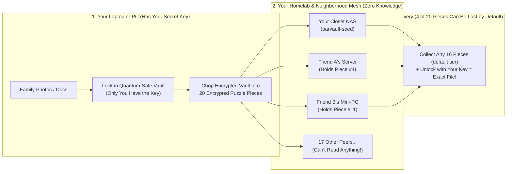
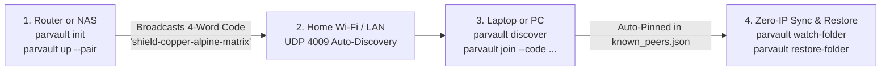

# Neighborhood Cloud (`parvault` & `parvault-seed`) — Homelab & Everyday User Quickstart Guide

> **No CS or math degree required.** If you know how to run a command in a terminal (or spin up a Docker container / Raspberry Pi), this guide will get your files backed up with **zero monthly cloud bills** and **zero trust** in anyone else's computer.

> [!WARNING]
> **Pre-release.** `v0.5.0` is not released and has no installer or binary download. Build from source first (`cargo build --release`, then put `target/release/parvault` and `target/release/parvault-seed` on your `PATH`). Multi-machine setups have been tested only in Docker and on one host, not on real router hardware. The limits are listed in the [README](README.md#known-limits-v050).

---

## 1. What Is This? (The 60-Second Plain-English Version)

### Why Traditional Backups Fall Short
Every homelabber and self-hoster eventually hits the same painful choice:
1. **Big Tech Cloud Storage:** Charges you every single month forever, throttles your uploads, and holds the keys to scan, lock, or leak your private files.
2. **A Single NAS or USB Drive in Your Closet:** Costs \$0/month, **until** your house has a pipe burst, a fire, a burglary, a lightning strike, or a ransomware attack—and takes both your computer and your backup drive with it.

### How Neighborhood Cloud Fixes This (`BitTorrent` + `Syncthing` + `A Quantum-Safe Puzzle Box`)
Neighborhood Cloud lets your computers, your home server, and your friends' or neighbors' home servers team up to back each other up automatically—**without anyone ever being able to see anyone else's files:**

1. **Step 1 — Locked in a Quantum-Safe Vault Before It Leaves Your Machine:**
   Before a photo or document ever touches your network card, `parvault` pads its size and encrypts it with **`AES-256-GCM`**. The list of your files (the folder catalog and manifest) is also sealed with a post-quantum cascade. Your secret **Master Key** never leaves your computer.
2. **Step 2 — Chopped into 20 "Space-Probe" Puzzle Pieces ("Shards"):**
   Using **Reed-Solomon erasure coding** (the exact same math NASA uses to talk to deep-space probes across the solar system), that locked vault is split into **20 puzzle pieces** and spread across the ring members you store on.
   - **Here's the magic:** You **don't** need all 20 pieces to get your file back!
   - By default (**`--tier homelab`, `16-of-20`**), **any 16 pieces** reconstruct your file using only **1.25x** storage, so 4 pieces can be lost. `--tier consumer` (`10-of-20`) survives losing 10 pieces at 2x storage. You choose the tier; it does not change on its own yet.
   - **With one paired router, all 20 pieces sit on that router.** That protects against bit rot on its disk, not against losing the router. Spread pieces by adding more ring members.
3. **Step 3 — What the Machines Holding Your Pieces Can See:**
   Only encrypted bytes: they cannot read your files. They do see which ring member sent each piece, and the piece file names show which pieces belong to the same stripe. <!-- claim: planned -->(planned) Hiding that (blinded names and relaying uploads through a neighbor) in the CLI.



---

## 2. Which Binary Should I Run? (`parvault` vs. `parvault-seed`)

Neighborhood Cloud builds five binaries; this guide uses these two:

| Binary | Who Should Run It? | What Does It Do? | Can It Read My Files? |
| :--- | :--- | :--- | :---: |
| **`parvault`**<br>*(The Everyday Backup & Sync App)* | **Your personal computers** (laptop, gaming PC, desktop workstation, or a server whose own folders you want to back up). | Encrypts your files, watches folders for changes (`watch-folder`), previews diffs (`diff-folder`), restores backups (`restore-folder`), and trades encrypted puzzle pieces. | **Yes** (on *your* machine, because it holds your secret Master Key). |
| **`parvault-seed`**<br>*(The Dedicated Zero-Trust Backup & Bootstrap Server)* | **Always-on headless hardware** with spare disk space: a Raspberry Pi, an Unraid/TrueNAS box in your closet, an old mini-PC, or a cheap VPS. | Holds anonymized, encrypted puzzle pieces (`--mode homelab-vault` or `--mode public-bootstrap`), answers uptime health checks, and earns **High-Uptime Homelab status** for you. | **NO — Never.** It holds **zero decryption keys** and only ever sees random-looking puzzle pieces. |

---

## 3. Zero-IP Home Network Quickstart (No IP Addresses Needed!)

In `v0.5.0`, you **never have to look up or type IP addresses** on one home LAN. Nodes auto-discover each other on your home network via cryptographically signed beacons, pair in seconds with a 4-word code, and auto-heal if your router assigns a new DHCP address.



### Step 1: Initialize Your Vault (`parvault init`)
On your computer, home server, or router, generate cryptographic keys and a `config.toml`:
<!-- doc-cmd: node router -->
```bash
parvault init --profile router-soc --watch /mnt/usb-nas/shared --label "Home-NAS"
# Start your ring, once, before `parvault up`: only ring members can store data on each other
parvault wot init
```
It prints the data directory, the node's peer ids and its owner fingerprint. It prints no recovery phrase: see Recipe A for how recovery works.

---

### Step 2: Turn on Turnkey Cloud-NAS Appliance Mode (`parvault up`)
On your router, closet NAS, or Raspberry Pi, launch everything with one command:
<!-- doc-cmd: node router -->
<!-- doc-cmd: background ready="Embedded Status Server listening" -->
<!-- doc-cmd: capture PAIRING_CODE="Home LAN Pairing Code: (\S+)" -->
```bash
parvault up \
  --profile router-soc \
  --folder /mnt/usb-nas/shared \
  --status-http 0.0.0.0:4080 \
  --pair
```
This automatically starts:
1. The **P2P storage daemon** (1 MiB stripes; <!-- metric:docker.live_rss -->`8.63 MiB`<!-- /metric --> resident in the Docker gate's 48 MiB container),
2. The **Signed LAN Beacon Responder** on UDP `4009`,
3. The **Embedded Status Dashboard** on `http://localhost:4080`,
4. An active **4-word pairing code** (e.g. `shield-copper-alpine-matrix`).

The status page needs a read-only token on every request (v0.5.0): run `parvault token mint --read-only` on the node, open `http://<node-ip>:4080`, and enter the token as the password (any user name), or send `Authorization: Bearer <token>` to `/api/v1/health`. The token goes only in that header, never in the URL: `?token=` is ignored and refused. Use an IP address or `localhost`, not a host name: DNS names are refused (DNS rebinding). Without `--status-http` there is no status listener.

---

### Step 3: Auto-Discover & Pair with 4 Words (`parvault discover` & `join`)
On your laptop or workstation (connected to the same home Wi-Fi/LAN):

<!-- doc-cmd: node laptop -->
```bash
# 1. Scan your home network (zero IP addresses required!)
parvault discover
```
Output:
```text
DISCOVERED PARVAULT PEERS (Zero-IP Configuration)
----------------------------------------------------------------------------------------------------------
Label              | Role         | Multiaddr (Pinned PeerId)                              | Free Space
----------------------------------------------------------------------------------------------------------
Home-NAS           | router-nas   | /ip4/192.168.1.1/tcp/4001/p2p/12D3KooWBPqPNYp6...      | 32.0 GiB
----------------------------------------------------------------------------------------------------------
Discovered 1 verified peer(s). Pinned in .parvault-data/known_peers.json.
```

<!-- doc-cmd: node laptop -->
```bash
# 2. Pair permanently using the 4-word code shown on your router (e.g. shield-copper-alpine-matrix)
parvault join --code <PAIRING_CODE>
```
Output:
```text
Paired with Home-NAS (12D3KooWBPqPNYp6...) — zero IP config ready!
Pinned Multiaddr: /ip4/192.168.1.1/tcp/4001/p2p/12D3KooWBPqPNYp6...
```

---

### Step 3b: Join the Ring (Required to Store Data)
Pairing finds and pins your router; storing data on it needs ring membership. The router started the ring in Step 1; invite each device. On the laptop, note its "Ed25519 Public Key":

<!-- doc-cmd: node laptop -->
<!-- doc-cmd: capture LAPTOP_ED25519_KEY="Ed25519 Public Key \(hex\): ([0-9a-f]{64})" -->
```bash
parvault identity
```

On the router, invite it; this prints a token:

<!-- doc-cmd: node router -->
<!-- doc-cmd: capture TOKEN="^([0-9a-f]{128,})" -->
```bash
parvault wot invite --peer <LAPTOP_ED25519_KEY>
```

On the laptop, install the token:

<!-- doc-cmd: node laptop -->
```bash
parvault wot install-chain --token <TOKEN>
```

A device outside the ring is refused with `peer not admitted; v0.5.0 requires ring admission`.

---

### Step 4: Back Up and Sync Folders (Zero IP Flags!)
Backup and restore commands find your paired storage nodes automatically; storing on them needs ring membership (Step 3b):

<!-- doc-cmd: node laptop -->
```bash
mkdir -p ~/Documents && echo "example" > ~/Documents/tax-return.pdf   # a file to back up
# Optional: a recovery phrase makes this folder recoverable on a new machine (Recipe A).
# Write the phrase down offline; parvault stores it nowhere.
export PARVAULT_SEED_PHRASE="$(parvault new-seed-phrase)"; echo "$PARVAULT_SEED_PHRASE"

# Back up personal documents incrementally (filters .git, node_modules automatically)
parvault watch-folder \
  --folder ~/Documents \
  --vault-namespace documents \
  --snapshot-out ./documents.manifest.bin \
  --prune-deleted \
  --once
# If no ring peer takes the data, this prints "N stripe(s) kept only on this machine: NOT backed up"
# and exits with code 3: nothing left this machine. Pass --allow-local-only to accept that.
# "Backed up" means at least k shards are off this machine; with a lite seed they may all be on
# the seed itself (one other machine).

# Restore a single file or the whole directory tree (keep PARVAULT_SEED_PHRASE set and pass the
# same namespace if you backed up with a phrase; without one, omit --vault-namespace)
parvault restore-folder \
  --snapshot ./documents.manifest.bin \
  --vault-namespace documents \
  --out-dir ./restored-docs \
  --file "tax-return.pdf"
```

---

### Step 5: Zero-Pairing Public Commons Quickstart (`--public`)
Public Commons mode connects to a public swarm (analogous to a public BitTorrent tracker). **No public tracker is hosted today**: run your own `parvault-seed start --mode public-bootstrap` and use its address.

<!-- doc-cmd: skip reason="no public tracker is hosted (the docs say so)" -->
```bash
parvault watch-folder \
  --folder ~/Documents \
  --public \
  --tracker /ip4/<YOUR_SEED_IP>/tcp/4002/p2p/<SEED_PEER_ID> \
  --once
```
- **Zero pairing or join codes:** Anyone can join with a lightweight Hashcash Proof-of-Work ticket.
- **Client-Side Encryption:** Your files are encrypted with `AES-256-GCM` *before* leaving your machine. Stranger nodes only ever see encrypted shards.
- **10-of-20 Reed-Solomon:** Reconstructs your files even if 10 out of 20 stranger machines abruptly power off!

---

## 4. Advanced Homelab Recipes

### Recipe A: "House Fire" Recovery from a Recovery Phrase (Opt-In)
What if your laptop is lost or destroyed? A folder can be recovered on a new machine **only if you backed it up with a recovery phrase**, and only while ring members holding its pieces are still reachable. `parvault init` prints no phrase, and folders served by `parvault up --folder` have no phrase recovery.

1. Before anything goes wrong, make a phrase and back up with it (write the phrase down offline; it is never stored):
<!-- doc-cmd: node laptop -->
```bash
export PARVAULT_SEED_PHRASE="$(parvault new-seed-phrase)"; echo "$PARVAULT_SEED_PHRASE"
parvault watch-folder --folder ~/Documents --vault-namespace documents --once
```
2. On the new machine, which must reach the ring's nodes, recover with the same phrase and namespace. Ring membership gates storing and publishing, not reading. Anyone holding the owner's recovery key can restore from any reachable member without an invitation; it cannot store until invited. Members serve only ciphertext.
<!-- doc-cmd: skip reason="a new machine that reaches the ring; the Docker gate (stage 10) runs recover-from-seed" -->
```bash
export PARVAULT_SEED_PHRASE="<your 24 words>"
parvault recover-from-seed --vault-namespace documents --out-dir ./recovered-after-fire
```
For example, the BIP-39 test vector `legal winner thank year wave sausage worth useful legal winner thank year wave sausage worth useful legal winner thank year wave sausage worth title` is a valid phrase; never use a published phrase for real data. Prefer `PARVAULT_SEED_PHRASE` over `--seed-phrase`, which other users can see in the process list.

`parvault` re-derives the vault keys from the phrase, finds the encrypted folder catalog on the ring's DHT, downloads the surviving pieces, and rebuilds every file. A wrong phrase or namespace fails and writes nothing.

---

### Recipe B: Link Personal Devices with Zero Reciprocity Tax (`issue-device-cert`)
To link machines into a private Day-1 Personal Ring (<!-- claim: planned -->(planned) zero storage quota tax for linked devices: not applied yet):
<!-- doc-cmd: skip reason="the certificate and the issuer's owner key come from two machines' output" -->
```bash
# 1. On your laptop, issue a certificate for your desktop or NAS. For a lite seed
#    (watch-folder --lite-seed-dir), certify the "Vault Device Peer ID" that
#    `parvault identity --seed-phrase ... --vault-namespace ...` prints instead.
parvault issue-device-cert \
  --device-peer-id "parvault-peer-8f3a9c12e4b07d11" \
  --device-label "Work-Laptop"

# 2. Verify it on the destination machine against the issuer's owner key
#    ("Owner PQ Public Key Hex" in `parvault identity` on the issuing laptop):
parvault-seed verify-device-cert --data-dir /mnt/nas/parvault-seed \
  --cert "PARVAULT-CERT-V1:<hex>" \
  --owner-pq-pubkey-hex <ISSUER_OWNER_PQ_PUBLIC_KEY_HEX>
```

---

### Recipe C: Scrub for Silent Disk Bit-Rot & Check Uptime Status
<!-- doc-cmd: node laptop -->
```bash
# Check node storage quota and the standing tiers:
parvault status

# Verify every local shard against silent disk corruption:
parvault scrub
```

---

### Recipe D: Evict a Bad Actor or Content Takedown (`parvault evict`, `ADR-25`, `ADR-26`)
If a spammer or illegal content is detected, administrators can purge matching shards with zero-wipe `0x00` disk shredding and block future ingress without storing any plaintext IPs on disk:

<!-- doc-cmd: skip reason="needs a stripe root from an abuse report; the Docker gate (stages 7b, 9) runs evict" -->
```bash
# Evict an abusive IP address and purge all associated shards:
parvault evict --ip 203.0.113.42 --reason "Spam flood"

# Purge and permanently block an illegal content stripe across mesh peers:
# --merkle-root takes a full 64-hex stripe Merkle root. `parvault list-snapshot --snapshot <file>`
# prints each file's stripe roots (`stripe N root=...`); an abuse report names the stripe too.
# File and folder roots are not stripe roots (they only coincide for a one-stripe file).
parvault evict --merkle-root <STRIPE_MERKLE_ROOT_HEX> --propagate
```

---

### Recipe E: Report Abusive Content & Public Tracker Administration (`ADR-26`)
This needs a public tracker you run yourself (none is hosted today). On Public Commons swarms (`--public`), random users cannot grief or evict honest users. To report illegal content, submit a cryptographic burden-of-proof report (`parvault report-abuse`). The Public Tracker Operator reviews cryptographic proofs and issues official eviction orders:

<!-- doc-cmd: skip reason="no public tracker is hosted (the docs say so)" -->
```bash
# 1. Reporter: submit leaked manifest and key proving illegal content distribution:
parvault report-abuse \
  --tracker /ip4/<YOUR_SEED_IP>/tcp/4002/p2p/<SEED_PEER_ID> \
  --manifest ./contraband.manifest.bin \
  --disclosed-key-hex <DISCLOSED_KEY_HEX> \
  --allegation "CSAM / DMCA takedown violation"

# 2. Tracker Operator: review queue and approve mesh-wide shredding:
parvault-seed admin list-takedowns --data-dir /mnt/nas/parvault-seed
parvault-seed admin approve-takedown --data-dir /mnt/nas/parvault-seed --report-id <REPORT_ID> --note "Confirmed violation" --propagate

# 3. Tracker Operator: emergency unilateral eviction on formal legal/police warrant:
parvault-seed admin emergency-evict --data-dir /mnt/nas/parvault-seed --ip 203.0.113.66 --warrant-ref "WARRANT-1234" --propagate
```

---

### Recipe F: Browse Your Vault over WebDAV (Token Required)

`parvault up --no-socket --vfs-seed-dir <DIR> --vfs-webdav-listen 127.0.0.1:8088` serves your vault as a WebDAV drive. Every request needs a read-only token from the same data directory:

<!-- doc-cmd: node laptop -->
<!-- doc-cmd: background ready="WebDAV" -->
```bash
parvault up --no-socket --vfs-seed-dir ~/Documents --vfs-webdav-listen 127.0.0.1:8088
```

<!-- doc-cmd: node laptop -->
```bash
TOKEN="$(parvault token mint --read-only --ttl-secs 86400)"
curl -H "Authorization: Bearer $TOKEN" http://127.0.0.1:8088/
```

Clients that cannot send a Bearer token (Finder, davfs2, Windows) use any user name and the token as the password.

> [!WARNING]
> There is no TLS in `v0.5.0`. On loopback (`127.0.0.1`) nothing leaves the machine, but over a LAN the token travels **in clear** and anyone who sees it can read your vault until it expires. Keep `--ttl-secs` short. Built-in TLS is planned for `v0.6.0`.

**Windows:** its WebDAV client sends Basic auth over plain HTTP only after you allow it. In an administrator prompt run `reg add HKLM\SYSTEM\CurrentControlSet\Services\WebClient\Parameters /v BasicAuthLevel /t REG_DWORD /d 2 /f`, then restart the `WebClient` service (`net stop webclient && net start webclient`).

## 5. Planned: The Automatic "Trust & Storage Ladder"

<!-- claim: planned -->(planned) **Not active yet.** Today `watch-folder` and `up` use the tier you pass with `--tier`: `consumer` (10-of-20), `homelab` (16-of-20, the default), `mixed` (16-of-24) or `relay` (20-of-24). The ladder below is the design: a node would climb it based on how many peers are around and how reliably it stays online.

| Stage | Who Is Connected? | Puzzle Pieces (`K-of-N`) | How Many Machines Can Die at Once? | Storage Space Needed per `100 GB` Backed Up |
| :--- | :--- | :---: | :---: | :---: |
| **1. Personal Ring** | Just your own devices (`PersonalDeviceCert`) | **`2-of-3`** | **1 of 3** machines can die | **Free (`0 GB` external quota)** |
| **2. Buddy Co-Op** | **1 to 5** friends' homelabs | **`3-of-5`** | **2 of 5** machines can die | **`167 GB`** (`60%` efficiency) |
| **3. New Neighbor (Default)** | **6+ peers** (New / unproven laptop or PC) | **`10-of-20`** | **10 of 20 (`50%`!)** can die | **`200 GB`** (`50%` efficiency) |
| **4. Verified Neighbor** | Earned after **50+ health checks** ($\ge 98\%$ uptime) | **`16-of-24`** | **8 of 24** machines can die | **`150 GB`** (`66.7%` efficiency) |
| **5. Homelab Anchor** | Earned after **200+ health checks** ($\ge 99.8\%$ uptime) | **`16-of-20`** | **4 of 20** machines can die (+ auto-heals at `18/20`) | **`125 GB`** (`80%` efficiency + `5x` quota bonus!) |

---

## 6. Where to Go Next
- **[Router SoC Hardware & Firmware Integration Guide (`docs/ROUTER_SOC_HARDWARE_GUIDE.md`)](docs/ROUTER_SOC_HARDWARE_GUIDE.md):** Turnkey OpenWrt `procd`, prplOS LXC containers, MediaTek Filogic / Rockchip RAM budgeting (`< 16 MiB`), and embedded status dashboards.
- **[User & CLI Reference Manual (`docs/USER_AND_CLI_GUIDE.md`)](docs/USER_AND_CLI_GUIDE.md):** Every CLI flag for `parvault` and `parvault-seed`, `config.toml` rate limiting, and `.parvaultignore` rules.
- **[Security & Cryptography Architecture (`docs/SECURITY_AND_CRYPTOGRAPHY.md`)](docs/SECURITY_AND_CRYPTOGRAPHY.md):** Mathematical proofs, post-quantum `ML-KEM-768` / `ML-DSA-65` combiners, and TLA+ formal verification results.
