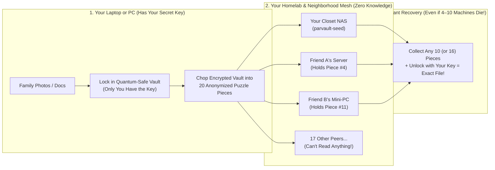
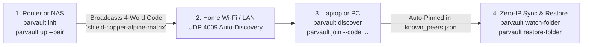

# Neighborhood Cloud (`parvault` & `parvault-seed`) — Homelab & Everyday User Quickstart Guide

> **No CS or math degree required.** If you know how to run a command in a terminal (or spin up a Docker container / Raspberry Pi), this guide will get your files backed up with **zero monthly cloud bills** and **zero trust** in anyone else's computer.

---

## 1. What Is This? (The 60-Second Plain-English Version)

### Why Traditional Backups Fall Short
Every homelabber and self-hoster eventually hits the same painful choice:
1. **Big Tech Cloud Storage:** Charges you every single month forever, throttles your uploads, and holds the keys to scan, lock, or leak your private files.
2. **A Single NAS or USB Drive in Your Closet:** Costs \$0/month, **until** your house has a pipe burst, a fire, a burglary, a lightning strike, or a ransomware attack—and takes both your computer and your backup drive with it.

### How Neighborhood Cloud Fixes This (`BitTorrent` + `Syncthing` + `A Quantum-Safe Puzzle Box`)
Neighborhood Cloud lets your computers, your home server, and your friends' or neighbors' home servers team up to back each other up automatically—**without anyone ever being able to see anyone else's files:**

1. **Step 1 — Locked in a Quantum-Safe Vault Before It Leaves Your Machine:**
   Before a photo or document ever touches your network card, `parvault` pads its size (so nobody can even guess what kind of file it is) and locks it inside a **dual-layer, post-quantum encrypted vault** (`AES-256-GCM` + NIST post-quantum `ML-KEM-768` / `ML-DSA-65`). Your secret **Master Key** never leaves your computer.
2. **Step 2 — Chopped into 20 "Space-Probe" Puzzle Pieces ("Shards"):**
   Using **Reed-Solomon erasure coding** (the exact same math NASA uses to talk to deep-space probes across the solar system), that locked vault is split into **20 puzzle pieces** and spread across different machines.
   - **Here's the magic:** You **don't** need all 20 pieces to get your file back!
   - In standard **Consumer Mode (`10-of-20`)**, **any 10 pieces** out of 20 reconstruct your entire file—meaning **half the network (10 computers!) can explode at the same time** and you lose **zero bytes**.
   - Once your 24/7 home server proves it stays online, it automatically unlocks **Homelab Mode (`16-of-20`)**, where **any 16 pieces** reconstruct your file using only **1.25x** total storage space (`80%` efficiency) instead of making 2x or 3x full copies!
3. **Step 3 — Completely Anonymized ("Blinded") Puzzle Pieces:**
   Every puzzle piece is given a random disguise ("blinded locator") and passed through a neighbor relay. The computers holding your puzzle pieces have **zero idea** what the file is, whose computer sent it, or which other puzzle pieces belong to the same file.



---

## 2. Which Binary Should I Run? (`parvault` vs. `parvault-seed`)

Neighborhood Cloud builds **two small, self-contained binaries** so you never have to install heavy software on a headless server:

| Binary | Who Should Run It? | What Does It Do? | Can It Read My Files? |
| :--- | :--- | :--- | :---: |
| **`parvault`**<br>*(The Everyday Backup & Sync App)* | **Your personal computers** (laptop, gaming PC, desktop workstation, or a server whose own folders you want to back up). | Encrypts your files, watches folders for changes (`watch-folder`), previews diffs (`diff-folder`), restores backups (`restore-folder`), and trades encrypted puzzle pieces. | **Yes** (on *your* machine, because it holds your secret Master Key). |
| **`parvault-seed`**<br>*(The Dedicated Zero-Trust Backup & Bootstrap Server)* | **Always-on headless hardware** with spare disk space: a Raspberry Pi, an Unraid/TrueNAS box in your closet, an old mini-PC, or a cheap VPS. | Holds anonymized, encrypted puzzle pieces (`--mode homelab-vault` or `--mode public-bootstrap`), answers uptime health checks, and earns **High-Uptime Homelab status** for you. | **NO — Never.** It holds **zero decryption keys** and only ever sees random-looking puzzle pieces. |

---

## 3. Zero-IP Home Network Quickstart (No IP Addresses Needed!)

In `v0.3.0`, you **never have to look up or type IP addresses**. Nodes auto-discover each other on your home network via cryptographically signed beacons, pair in seconds with a 4-word code, and auto-heal if your router assigns a new DHCP address.



### Step 1: Initialize Your Vault (`parvault init`)
On your computer, home server, or router, generate cryptographic keys and a 24-word recovery phrase:
```bash
parvault init --profile router-soc --watch /mnt/usb-nas/shared --label "Home-NAS"
```
Output:
```text
[parvault] Initialized node identity in .parvault-data
[parvault] Persistent Device Peer ID: parvault-peer-8f3a9c12e4b07d11
[parvault] ----------------------------------------------------------------------
[parvault] 24-Word Recovery Mnemonic (Write this down!):
[parvault] velvet orbit oak anchor matrix copper alpine shield
[parvault] beacon crystal meadow timber galaxy canyon breeze horizon
[parvault] river summit forest harbor ripple valley shadow summit
[parvault] ----------------------------------------------------------------------
[parvault] Created configuration file at .parvault-data/config.toml
```

---

### Step 2: Turn on Turnkey Cloud-NAS Appliance Mode (`parvault up`)
On your router, closet NAS, or Raspberry Pi, launch everything with one command:
```bash
parvault up \
  --profile router-soc \
  --folder /mnt/usb-nas/shared \
  --status-http 0.0.0.0:4080 \
  --pair
```
This automatically starts:
1. The **P2P storage daemon** (using 1 MiB stripes so RAM stays `< 16 MiB`),
2. The **Signed LAN Beacon Responder** on UDP `4009`,
3. The **Embedded Status Dashboard** on `http://localhost:4080`,
4. An active **4-word pairing code** (e.g. `shield-copper-alpine-matrix`).

---

### Step 3: Auto-Discover & Pair with 4 Words (`parvault discover` & `join`)
On your laptop or workstation (connected to the same home Wi-Fi/LAN):

```bash
# 1. Scan your home network (zero IP addresses required!)
parvault discover
```
Output:
```text
DISCOVERED HOME LAN PEERS (Zero-IP Configuration)
------------------------------------------------------------------------------------------------------
Label           Role        Multiaddr (Pinned Peer ID)                           Available    Status
------------------------------------------------------------------------------------------------------
Home-NAS        router-nas  /ip4/192.168.1.1/tcp/4001/p2p/12D3KooWSDu...        476.2 GiB    Online
------------------------------------------------------------------------------------------------------
```

```bash
# 2. Pair permanently using the 4-word code shown on your router
parvault join --code shield-copper-alpine-matrix
```
Output:
```text
[parvault] Verified signed beacon from 'Home-NAS' (12D3KooWSDu...)!
[parvault] Successfully paired and pinned in known_peers.json! Zero-IP config ready.
```

---

### Step 3b: Join the Ring (Required to Store Data)
Pairing finds and pins your router; storing data on it needs ring membership. Start the ring once on the router (before `parvault up`), then invite each device:

```bash
parvault wot init                                   # router, once
parvault identity                                   # laptop: note "Ed25519 Public Key"
parvault wot invite --peer <LAPTOP_ED25519_KEY>     # router: prints a token
parvault wot install-chain --token <TOKEN>          # laptop
```

A device outside the ring is refused with `peer not admitted; v0.5.0 requires ring admission`.

---

### Step 4: Back Up and Sync Folders (Zero IP Flags!)
Backup and restore commands find your paired storage nodes automatically; storing on them needs ring membership (Step 3b):

```bash
# Back up personal documents incrementally (filters .git, node_modules automatically)
parvault watch-folder \
  --folder ~/Documents \
  --snapshot-out ./documents.manifest.bin \
  --prune-deleted \
  --once

# Restore a single file or the whole directory tree on another machine
parvault restore-folder \
  --snapshot ./documents.manifest.bin \
  --out-dir ./restored-docs \
  --file "tax-return.pdf"
```

---

### Step 5: Zero-Pairing Public Commons Quickstart (`--public`)
Want to back up files without pairing with anyone? You can connect to the open Public Commons swarm (analogous to a public BitTorrent tracker):

```bash
parvault watch-folder \
  --folder ~/Documents \
  --public \
  --tracker /dns4/tracker.neighborhoodcloud.org/tcp/4002/p2p/12D3KooW... \
  --once
```
- **Zero pairing or join codes:** Anyone can join immediately with a lightweight Hashcash Proof-of-Work ticket.
- **Client-Side Quantum-Safe Encryption:** Your files are locked with `AES-256-GCM` + Post-Quantum keys *before* leaving your machine. Stranger nodes only ever see encrypted shards.
- **10-of-20 Reed-Solomon:** Reconstructs your files even if 10 out of 20 stranger machines abruptly power off!

---

## 4. Advanced Homelab Recipes

### Recipe A: Zero-Local-State "House Fire" Recovery (24-Word Recovery Phrase)
What if your house burns down, destroying your laptop, your router, and all local files?
When running `parvault init` or `watch-folder`, you received a 24-word recovery phrase. On a brand-new machine anywhere in the world:

```bash
parvault recover-from-seed \
  --seed-phrase "velvet orbit oak anchor matrix copper alpine shield beacon crystal meadow timber galaxy canyon breeze horizon river summit forest harbor ripple valley shadow summit" \
  --vault-namespace "default" \
  --out-dir ./recovered-after-fire
```
`parvault` deterministically re-derives your root Master Key, locates your encrypted vault catalog on the network DHT, downloads the surviving puzzle pieces, and reconstructs every file!

---

### Recipe B: Link Personal Devices with Zero Reciprocity Tax (`issue-device-cert`)
To link machines into a private Day-1 Personal Ring with **zero storage quota tax (`0.00x`)**:
```bash
# 1. On your laptop, issue a certificate for your desktop or NAS:
parvault issue-device-cert \
  --device-peer-id "parvault-peer-8f3a9c12e4b07d11" \
  --device-label "Work-Laptop"

# 2. Verify and pin on the destination machine:
parvault-seed verify-device-cert \
  --cert "PARVAULT-CERT-V1:<hex>"
```

---

### Recipe C: Scrub for Silent Disk Bit-Rot & Check Uptime Status
```bash
# Check node storage quota, resident RAM, and Earned Standing ladder:
parvault status

# Verify every local shard against silent disk corruption:
parvault scrub
```

---

### Recipe D: Evict a Bad Actor or Content Takedown (`parvault evict`, `ADR-19`)
If a spammer or illegal content is detected, administrators can purge matching shards with zero-wipe `0x00` disk shredding and block future ingress without storing any plaintext IPs on disk:

```bash
# Evict an abusive IP address and purge all associated shards:
parvault evict --ip 203.0.113.42 --reason "Spam flood"

# Purge and permanently block an illegal content stripe across mesh peers:
parvault evict --merkle-root <MERKLE_ROOT_HEX> --propagate
```

---

### Recipe E: Report Abusive Content & Public Tracker Administration (`ADR-19`)
On Public Commons swarms (`--public`), random users cannot grief or evict honest users. To report illegal content, submit a cryptographic burden-of-proof report (`parvault report-abuse`). The Public Tracker Operator reviews cryptographic proofs and issues official eviction orders:

```bash
# 1. Reporter: submit leaked manifest and key proving illegal content distribution:
parvault report-abuse \
  --tracker /dns4/tracker.neighborhoodcloud.org/tcp/4002/p2p/... \
  --manifest ./contraband.manifest.bin \
  --disclosed-key-hex <DISCLOSED_KEY_HEX> \
  --allegation "CSAM / DMCA takedown violation"

# 2. Tracker Operator: review queue and approve mesh-wide shredding:
parvault-seed admin list-takedowns --data-dir /mnt/nas/parvault-seed
parvault-seed admin approve-takedown --report-id <REPORT_ID> --note "Confirmed violation" --propagate

# 3. Tracker Operator: emergency unilateral eviction on formal legal/police warrant:
parvault-seed admin emergency-evict --data-dir /mnt/nas/parvault-seed --ip 203.0.113.66 --warrant-ref "WARRANT-1234" --propagate
```

---

## 5. How the Automatic "Trust & Storage Ladder" Works

Your node automatically climbs the **Earned Uptime Ladder** based on how many peers are around and how reliably your machine stays online:

| Stage | Who Is Connected? | Puzzle Pieces (`K-of-N`) | How Many Machines Can Die at Once? | Storage Space Needed per `100 GB` Backed Up |
| :--- | :--- | :---: | :---: | :---: |
| **1. Personal Ring** | Just your own devices (`PersonalDeviceCert`) | **`2-of-3`** | **1 of 3** machines can die | **Free (`0 GB` external quota)** |
| **2. Buddy Co-Op** | **1 to 5** friends' homelabs | **`3-of-5`** | **2 of 5** machines can die | **`167 GB`** (`60%` efficiency) |
| **3. New Neighbor (Default)** | **6+ peers** (New / unproven laptop or PC) | **`10-of-20`** | **10 of 20 (`50%`!)** can die | **`200 GB`** (`50%` efficiency) |
| **4. Verified Neighbor** | Earned after **50+ health checks** ($\ge 98\%$ uptime) | **`16-of-24`** | **8 of 24** machines can die | **`150 GB`** (`66.7%` efficiency) |
| **5. Homelab Anchor** | Earned after **200+ health checks** ($\ge 99.8\%$ uptime) | **`16-of-20`** | **4 of 20** machines can die (+ auto-heals at `18/20`) | **`125 GB`** (`80%` efficiency + `5x` quota bonus!) |

---

## 6. Where to Go Next
- **[Router SoC Hardware & Firmware Integration Guide (`docs/ROUTER_SOC_HARDWARE_GUIDE.md`)](docs/ROUTER_SOC_HARDWARE_GUIDE.md):** Turnkey OpenWrt `procd`, prplOS LXC containers, MediaTek Filogic / Rockchip RAM budgeting (`< 16 MiB`), and embedded status dashboards.
- **[User & CLI Reference Manual (`docs/USER_AND_CLI_GUIDE.md`)](docs/USER_AND_CLI_GUIDE.md):** Every CLI flag for `parvault` and `parvault-seed`, `config.toml` rate limiting, and `.parvaultignore` rules.
- **[Security & Cryptography Architecture (`docs/SECURITY_AND_CRYPTOGRAPHY.md`)](docs/SECURITY_AND_CRYPTOGRAPHY.md):** Mathematical proofs, post-quantum `ML-KEM-768` / `ML-DSA-65` combiners, and TLA+ formal verification results.
