# ParVault (`parvault`, `parvault-seed`, `parvault-fuse`, `parvault-sync` & `parvault-bench`)
### Zero-Knowledge, Post-Quantum, Erasure-Coded P2P Storage Engine, Zero-Filesystem Seed Server & Dual-Mode `GatewayBus` Plugin Host (<!-- metric:crate_version_tag -->`v0.5.0`<!-- /metric -->)

**[License: `AGPL-3.0-only`](LICENSE)** &bull; **Rust `2021` Edition** &bull; **[Targets: `x86_64` | `aarch64` static `musl`](#build--verification-commands)** &bull; **[Model-Checked: <!-- metric:kani_harnesses -->`17`<!-- /metric --> Kani Bounded Model Checking Harnesses + <!-- metric:tla_specs -->`7`<!-- /metric --> TLA+ Specs](docs/SAFETY_AND_LINT_AUDIT.md)**

`parvault` (library crate `parvault`, binaries `parvault`, `parvault-seed`, `parvault-fuse`, `parvault-sync`, and `parvault-bench`) is a **zero-knowledge, post-quantum hybrid, Byzantine-resilient P2P backup, transport-agnostic `GatewayBus` plugin host, and lazy-streaming virtual filesystem engine** — essentially **"Filecoin without the coin"**, preserving genuine distributed storage systems engineering (erasure coding, stateless Proof-of-Retrievability, symmetric Byte-Epoch reciprocity, zero-knowledge encryption, `F_ADD_SEALS`-immutable `memfd` `SCM_RIGHTS` zero-copy IPC, and sub-millisecond `SO_PEERCRED` UID-bound Macaroon capabilities) while eliminating 100% of cryptocurrency tokens, wallets, gas fees, and blockchain bloat so it runs inside **<!-- metric:bench.soc.vmhwm_store -->`9.72 MiB`<!-- /metric --> RAM on a home router** (measured with `parvault-bench` on the router-soc store path, not on router hardware).

> [!WARNING]
> **Pre-release.** `v0.5.0` is not released. There is no installer or binary download: build from source (`cargo build --release`; the binaries land in `target/release/`) and put them on your `PATH` before running the commands below. Multi-node operation has been tested only in Docker (`scripts/docker_acceptance_gate.sh`) and with several data directories on one host, never on real router hardware. See [Known Limits](#known-limits-v050).

> [!TIP]
> **Built-In (`=y`) vs. Split-Plugin (`=m`) Architecture (<!-- metric:crate_version_tag -->`v0.5.0`<!-- /metric -->, [`ADR-32`](docs/adr/ADR-32-transport-agnostic-gateway-bus-and-memfd-sealing.md), [`ADR-33`](docs/adr/ADR-33-dual-mode-vfs-and-sibling-gateway-sync.md)):**
> - **`parvault` (this repository, `AGPL-3.0-only`):** Unified single-daemon core (`parvault up` with `--no-socket` + built-in `=y` `--vfs-webdav-listen` / `--vfs-fuse-fd` `GatewayBus::InProcess` mode or `--ipc-socket /var/run/parvault.sock` plugin-host mode, `parvault token {mint,attenuate,inspect}`, `parvault-seed --no-fs`, and canonical open-source sibling plugins `parvault-fuse` & zero-key `parvault-sync`), post-quantum cryptography, $GF(2^8)$ Reed-Solomon sharding, and formal verification (<!-- metric:kani_harnesses -->`17`<!-- /metric --> `cargo kani` harnesses + <!-- metric:tla_specs -->`7`<!-- /metric --> TLA+ TLC specs + <!-- metric:tests_total -->`226`<!-- /metric --> release tests).
> - **Hardened Out-of-Process Plugin Boundary ([`docs/GATEWAY_SOCKET_PROTOCOL.md`](docs/GATEWAY_SOCKET_PROTOCOL.md)):** `parvault-fuse`, zero-key `parvault-sync`, and downstream companion appliances (`parvault-suite`: `parvault-auth-broker`, `parvault-media-daemon`, `parvault-isp-agent`; and `parvault-control`) connect over `/var/run/parvault.sock` with kernel `SO_PEERCRED` UID allowlisting (`--strict-plugins --allow-peer-uid <UID>`), `F_ADD_SEALS` immutable `memfd` TOCTOU protection (`--require-sealed-memfd`), and offline-attenuated `PARVAULT-MAC-V1:` tokens without bloating or sharing `MasterKey` memory with the core daemon.

Designed to run identically on multi-terabyte homelab NAS servers and memory-constrained residential gateways (`prplOS` / `OpenWrt` LXC containers with a **`< 32 MiB` active RAM** target), `parvault` combines **16 MiB streaming `AES-256-GCM` encryption of file data** (the folder catalog and manifest are also sealed with the dual-cipher `PqVaultMasterKey` cascade, `AES-256-GCM` + `ChaCha20-Poly1305`), **Reed-Solomon erasure coding over $GF(2^8)$** (fixed per run with `--tier`, default 16-of-20), and **Stateless Stratified Proof-of-Retrievability (PoR)**, so that **no storage peer, witness node, or DHT router is trusted with plaintext.** Shard anonymization (blinded shard ids, onion upload) and earned uptime tiers are partly built; see [Known Limits](#known-limits-v050).

> [!NOTE]
> **Public Tracker Status:** We are **not** currently operating an official public tracker or public bootstrap swarm. **All `parvault` features work standalone without a public tracker** — including Zero-IP home LAN auto-discovery (`UDP 4009`), 4-word SAS pairing (`parvault pair` / `parvault join`), Router-SoC Cloud-NAS mode (`--profile router-soc`), personal multi-machine rings, and private self-hosted `parvault-seed` rendezvous/vault servers for friends, family, or organizations.
>
> **Public Swarm Readiness:** The codebase is engineered with multiple subsystems specifically designed to initialize and govern a public tracker (`parvault-seed --mode public-bootstrap`) when desired — including memory-hard Argon2id & Hashcash Sybil PoW (`PublicCommonsTicket`), Web-of-Trust (`WoT`) ring admission (slashing is applied locally only in `v0.5.0`), earned storage reciprocity tiers, 4-vector privacy-preserving keyed-HMAC eviction (`ADR-19`), $M$-of-$N$ federated council co-signing, and zero-private-key-on-VPS `admin_rpc` hooks.

---

## Documentation Hub (Choose Your Path)

| Guide | Audience | What's Inside |
| :--- | :--- | :--- |
| **[Homelab & Everyday User Quickstart (`QUICKSTART.md`)](QUICKSTART.md)** | **Homelabbers, Self-Hosters & Friend Co-Ops** | Plain-English (ELI15) overview and 5 copy-paste recipes (`parvault init`, `parvault up`, zero-IP `discover`, 4-word `join`, and 24-word "House Fire" recovery). |
| **[Router SoC Hardware & Firmware Integration Guide (`docs/ROUTER_SOC_HARDWARE_GUIDE.md`)](docs/ROUTER_SOC_HARDWARE_GUIDE.md)** | **Router Vendors, OpenWrt & prplOS Integrators** | Turnkey integration for MediaTek Filogic / Rockchip / x86_64 routers: memory/flash budgets, `procd` init scripts, LXC manifests, and embedded status dashboards. |
| **[Rust Library Embedding Guide (`docs/EMBEDDING.md`)](docs/EMBEDDING.md)** | **Rust Application & Firmware Developers** | Embedding `parvault` as a library crate: BIP-39 deterministic keys, `FolderSyncEngine`, zero-key `GatewayFolderSync`, `VirtualVaultFs::with_bus`, `RouterSoc` vs. `Desktop` memory profiles, and `admin_rpc` wire hooks. |
| **[Empirical Benchmarks & Memory Telemetry (`docs/BENCHMARKS.md`)](docs/BENCHMARKS.md)** | **Systems Engineers & Evaluators** | Reproducible `parvault-bench` throughput, `/proc/self/status` `VmHWM` (<!-- metric:bench.soc.vmhwm_store -->`9.72 MiB`<!-- /metric --> Router-SoC; <!-- metric:gw.ipc.gateway_vmhwm -->`10.98 MiB`<!-- /metric --> `parvault gateway`; <!-- metric:sync.rss_musl -->`6.15 MiB`<!-- /metric --> `parvault-sync`), static `musl` binary footprints (<!-- metric:size.all.range -->`2.94–7.77 MiB`<!-- /metric -->), and multi-container Docker gate `48m` cgroup results. |
| **[Gateway Socket & Plugin Protocol (`docs/GATEWAY_SOCKET_PROTOCOL.md`)](docs/GATEWAY_SOCKET_PROTOCOL.md)** | **Plugin Authors (`parvault-fuse`, `parvault-sync`, `parvault-suite`, Custom Daemons)** | Complete wire spec (`4-byte BE` + `bincode` + `SCM_RIGHTS` `memfd`), mandatory `F_ADD_SEALS` anti-TOCTOU contract, `SO_PEERCRED` `--strict-plugins`, `PARVAULT-MAC-V1:` tokens, dual-mode `GatewayBus`, and single-daemon rough-edges guide. |
| **[Memory Safety, OS-FFI & Lint Audit (`docs/SAFETY_AND_LINT_AUDIT.md`)](docs/SAFETY_AND_LINT_AUDIT.md)** | **Security & Rust Safety Auditors** | `#![deny(unsafe_code)]` / `#![forbid(unsafe_code)]` posture across all 5 binaries, complete `src/os_sys.rs` POSIX syscall `SAFETY` proof table (`memfd`, `F_ADD_SEALS`, `SO_PEERCRED`, `SCM_RIGHTS`), and full `#[allow(...)]` justification table. |
| **[User & CLI Reference Manual (`docs/USER_AND_CLI_GUIDE.md`)](docs/USER_AND_CLI_GUIDE.md)** | **System Administrators & Power Users** | Complete CLI flag reference for `parvault` and `parvault-seed`, `PARVAULT-CERT-V1:` / `PARVAULT-MAC-V1:` token workflows, `.parvaultignore` syntax, `config.toml` bandwidth rate limits, and bit-rot scrubbing. |
| **[Security & Cryptography Proofs (`docs/SECURITY_AND_CRYPTOGRAPHY.md`)](docs/SECURITY_AND_CRYPTOGRAPHY.md)** | **Cryptographers & Security Auditors** | Mathematical proofs, $\ge 2^{224}$ combinatorial anonymity bounds, NIST FIPS 203 `ML-KEM-768` & FIPS 204 `ML-DSA-65` hybrid combiners, <!-- metric:kani_harnesses -->17<!-- /metric --> Kani symbolic harnesses, <!-- metric:tla_specs -->7<!-- /metric --> TLA+ formal specs, and live Docker P2P regression reports. |
| **[Architectural Decision Records (`docs/ADR.md` & `docs/adr/`)](docs/ADR.md)** | **Distributed Systems Architects** | Master ADR Index, Active `v0.5.0` Cryptographic Suite Guide (`AES-256-GCM` vs. Post-Quantum), and **<!-- metric:adr_count -->33<!-- /metric --> single-concern ADRs (`ADR-01` – <!-- metric:adr_last -->`ADR-33`<!-- /metric -->)** in [`docs/adr/`](docs/adr/). |
| **[AI Agent & Engineer Guide (`AGENTS.md`)](AGENTS.md)** | **Contributors & Coding Agents** | Module-by-module map of `src/`, the **7 Non-Negotiable Zero-Trust & Memory-Safety Rules**, and exact build/test/TLC verification commands. See also [`CONTRIBUTING.md`](CONTRIBUTING.md) and [`SECURITY.md`](SECURITY.md). |

---

## 60-Second Quickstart (Zero-IP Home Network & Cloud-NAS)

```bash
# 1. Initialize keys and a config.toml on the router
parvault init --profile router-soc --watch /mnt/usb-nas/shared --label "Router-NAS"

# 2. Start your ring on the router (once). Only ring members can store data on each other.
parvault wot init

# 3. Launch turnkey Cloud-NAS appliance mode on your router or home server
parvault up \
  --profile router-soc \
  --folder /mnt/usb-nas/shared \
  --status-http 0.0.0.0:4080 \
  --pair

# 4. On your laptop: discover home LAN storage (no IP addresses to type) and pair with the code
parvault discover
parvault join --code shield-copper-alpine-matrix

# 5. Invite the laptop into the ring: print its key on the laptop, invite it on the router,
#    install the printed token on the laptop
parvault identity                                   # laptop: note "Ed25519 Public Key"
parvault wot invite --peer <LAPTOP_ED25519_KEY>     # router: prints a token
parvault wot install-chain --token <TOKEN>          # laptop

# 6. Incrementally back up files to the paired router. Optional but recommended: a recovery
#    phrase, so a fresh machine can restore this folder after losing this one (keep it offline)
export PARVAULT_SEED_PHRASE="$(parvault new-seed-phrase)"; echo "$PARVAULT_SEED_PHRASE"
parvault watch-folder --folder ~/Documents --vault-namespace laptop --once

# 7. Optional: connect to a self-hosted or community-initialized public tracker (--public):
#    (No official public tracker is currently hosted; supply your own parvault-seed multiaddr)
parvault watch-folder --folder ~/Documents --public --tracker /ip4/<YOUR_SEED_IP>/tcp/4002/p2p/<SEED_PEER_ID> --once
```

Discovery and pairing find and pin peers; storing data needs ring membership. A node outside the ring is refused with `peer not admitted; v0.5.0 requires ring admission`, and a node with no ring prints how to start or join one (`parvault wot init` or `parvault wot install-chain`).

With one paired router, all 20 shards of every stripe sit on that one machine: erasure coding protects against bit rot there, not against losing the router. Add more ring members to spread shards. Recovery after losing the laptop works only for folders backed up with a phrase (step 6): `PARVAULT_SEED_PHRASE="<phrase>" parvault recover-from-seed --vault-namespace laptop --out-dir ~/Recovered` on any ring member. Folders served by `parvault up --folder` have no phrase recovery.

---

## Core Architecture at a Glance

```mermaid
flowchart LR
    subgraph Client["1. Client Node (Possesses MasterKey & PqVaultMasterKey)"]
        F["Input Folder / File\n(.parvaultignore filtered)"] --> HASH["64 KiB Streaming SHA-256\n(Incremental Delta Check)"]
        HASH --> PAD["ISO Bucket Padding +\n16 MiB Streaming Chunker"]
        PAD --> AEAD["AES-256-GCM per stripe\n(PQ cascade: catalog and manifest only)"]
        AEAD --> RS["Reed-Solomon GF(2^8)\n(fixed --tier, default 16-of-20)"]
    end

    subgraph Anon["2. Placement (anonymization layers: seed/lite path and planned)"]
        RS --> BLIND["Blinded Locators (HMAC) +\nPer-Shard Cap Keys (V_i)\n(seed/lite path only)"]
        BLIND --> ONION["2-Layer PQ Onion Relay\n(nodes relay; CLI upload planned)"]
        ONION --> SPLIT{"70% Intra-ASN (<=5ms)\n30% Cross-Region DR\n<=4 Shards per /24"}
    end

    subgraph Audit["3. Stateless PoR & Zero-Knowledge Repair"]
        SPLIT --> POR["8-Stratum Stateless HMAC PoR\n(<=300ms RTT Bound)"]
        POR -->|"Drops to 18/20"| REP["Witness Cohort GF(2^8) Repair\n(RepairGrant + >=2 Receipts)"]
    end
```



| Capability | Cryptographic / Systems Mechanism | Governing ADR |
| :--- | :--- | :--- |
| **Bounded Gateway RAM (`< 32 MiB` target)** | 64 KiB streaming SHA-256 delta checks + fixed 16 MiB streaming encryption & Reed-Solomon stripes | `ADR-01`, `ADR-16` |
| **Router-SoC 1 MiB Profile** | Configurable 1 MiB stripes (`ROUTER_SOC_STRIPE_SIZE_BYTES`), <!-- metric:size.aarch64.range -->`2.94–6.08 MiB`<!-- /metric --> (`aarch64`) / <!-- metric:size.x86_64.range -->`3.63–7.77 MiB`<!-- /metric --> (`x86_64`) stripped static `musl` binaries (`soc` profile across `parvault`, `parvault-seed`, `parvault-fuse`, `parvault-sync`), <!-- metric:docker.unpacked -->`19.6 MB`<!-- /metric --> (<!-- metric:docker.compressed -->`6.13 MB`<!-- /metric --> compressed) `FROM scratch` container, <!-- metric:bench.soc.vmhwm -->`9.72–9.74 MiB`<!-- /metric --> peak `VmHWM` inside a 32–48 MiB cgroup | `ADR-18`, [`ADR-33`](docs/adr/ADR-33-dual-mode-vfs-and-sibling-gateway-sync.md) |
| **Zero-IP Home LAN & 4-Word Pairing** | Signed UDP beacons (port `4009`), 4-word BIP-39 SAS pairing, DHCP auto-healing in `known_peers.json` | `ADR-18` |
| **Online WAN Rendezvous & DDNS** | STUN-over-Noise address reflection, blinded rendezvous mailbox, dynamic-IP presence across ISP rotations | `ADR-18` |
| **Public Commons Swarm Mode** | Zero-pairing BitTorrent-style public tracker (`--public`), self-signed Hashcash PoW (`PublicCommonsTicket`) | `ADR-18` |
| **Post-Quantum Hybrids** | X-Wing `X25519 + ML-KEM-768` (FIPS 203), `Ed25519 + ML-DSA-65` (FIPS 204), and dual-cipher `PqVaultMasterKey` (`AES-256-GCM` + `ChaCha20-Poly1305`) for the folder catalog and manifest. File data is `AES-256-GCM` only. | `ADR-12` |
| **Shard Anonymization (partial)** | Keyed 256-bit `BlindedShardId`, per-shard capability keys $V_i$ and bearer quota vouchers on the seed/lite path; nodes relay 2-layer PQ onions. **Planned:** onion upload from the CLI. Regular `.shard` names reveal which shards share a stripe (W-05). | `ADR-11` |
| **Earned Standing (planned for erasure coding)** | `PersonalDeviceCert` rings, `FoundationSeedAnchor`s and `HighUptimeAnchor` standing exist in the library; the CLI does not yet pick erasure parameters from standing. `watch-folder` and `up` use `--tier` (default `homelab`, 16-of-20). | `ADR-13`, `ADR-14` |
| **Byzantine & Red-Team Hardening** | Pre-decoding Merkle quarantine, bounded `with_limit` wire framing (`32 MiB`), atomic `fsync`+`rename`, path-traversal blocking, and BIP-39 12/24-word seed recovery for folders backed up with `--seed-phrase` | `ADR-09`, `ADR-18` |
| **Privacy-Preserving Eviction Engine** | 4-vector bad-actor/content eviction (`parvault evict`), zero plaintext IPs on disk (`eviction_index.bin` HMAC tags), multi-pass `0x00` shredding, $M$-of-$N$ Public Tracker Council quorum (`cosign-eviction`), cryptographic reporter burden-of-proof (`parvault report-abuse`) | `ADR-19` |
| **Zero-Filesystem Bounded RAM Mode (`parvault-seed --no-fs`)** | Pure in-memory seed/bootstrap execution (`--no-fs --in-memory-mb <MiB>`, `--identity-env` / `--identity-file`) with **zero persistent directories or files** created, hard RAM byte-cap enforcement, and `0x00` `zeroize()` memory wiping on eviction/drop | [`ADR-30`](docs/adr/ADR-30-filesystem-free-in-memory-seed-mode.md) |
| **Transport-Agnostic `GatewayBus`, Sealed `memfd` & UID-Bound Macaroons** | Unified `GatewayBus` (`InProcess` `--no-socket` vs. `UnixSocket` `/var/run/parvault.sock`), `SCM_RIGHTS` zero-copy IPC with `F_ADD_SEALS` (`--require-sealed-memfd`) anti-TOCTOU protection, kernel `SO_PEERCRED` peer UID gating (`--strict-plugins --allow-peer-uid`), and offline `PARVAULT-MAC-V1:` caveats (`AllowedManifest`, `ByteRange`, `ExpiresAtUnixMs`, `ReadOnly`, `AllowedPeerUid`) | [`ADR-27`](docs/adr/ADR-27-zero-copy-uds-gateway-and-hedged-pool.md), [`ADR-28`](docs/adr/ADR-28-stateless-macaroon-capability-attenuation.md), [`ADR-32`](docs/adr/ADR-32-transport-agnostic-gateway-bus-and-memfd-sealing.md) |
| **Dual-Mode VFS (`=y` / `=m`) & Zero-Key Folder Sync (`parvault-fuse`, `parvault-sync`)** | Built-in `=y` (`parvault up --no-socket --vfs-webdav-listen`) or out-of-process `=m` (`parvault-fuse`) pure-Rust `/dev/fuse` (`ABI 7.31`, `0` C `libfuse3`, `0` `unsafe`, <!-- metric:fuse.ttfb -->`12.33 ms`<!-- /metric --> TTFB `< 50 ms`) + zero-key `parvault-sync` (`GatewayFolderSync` holding zero `MasterKey`/`NodeIdentity` secrets, `--macaroon` selective `pull`, Kani-verified path sanitizer) | [`ADR-29`](docs/adr/ADR-29-pure-rust-fuse-and-webdav-lazy-vfs.md), [`ADR-32`](docs/adr/ADR-32-transport-agnostic-gateway-bus-and-memfd-sealing.md), [`ADR-33`](docs/adr/ADR-33-dual-mode-vfs-and-sibling-gateway-sync.md) |
| **Machine-Checked Formal Verification (`cargo kani` + <!-- metric:tla_specs -->`7`<!-- /metric --> TLA+ Specs)** | **<!-- metric:kani_harnesses -->17<!-- /metric --> Kani Rust Bounded Model Checking symbolic harnesses** (`src/kani_proofs.rs`, `capabilities.rs`, `aes.rs`, `reed_solomon.rs`) + **<!-- metric:tla_specs -->7<!-- /metric --> exhaustive TLA+ TLC specifications** (`specs/*.tla`, <!-- metric:tlc.distinct -->`4,467`<!-- /metric --> distinct states, `0` errors) + <!-- metric:tests_pass -->`226 / 226`<!-- /metric --> release tests + `#![deny(unsafe_code)]` / `#![forbid(unsafe_code)]` | [`ADR-31`](docs/adr/ADR-31-unsafe-remediation-and-os-sys-ffi-boundary.md), [`ADR-01`–<!-- metric:adr_last -->`ADR-33`<!-- /metric -->](docs/ADR.md) |

---

## Known Limits (v0.5.0)

- **Pre-release:** no installer or binary download; build from source. Multi-node behaviour is tested only in Docker and on one host, not on router hardware.
- **Encryption:** file data is `AES-256-GCM`. The post-quantum `PqVaultMasterKey` cascade covers only the folder catalog and manifest.
- **Anonymity:** the CLI uploads shards directly to ring peers; onion upload is planned (nodes already relay onions). Regular shard file names start with the stripe's Merkle-root prefix and shard index, so a storage node can tell which shards share a stripe and count stripes (W-05, [`docs/security/TRUST_FINDINGS.md`](docs/security/TRUST_FINDINGS.md)). Blinded `.bshard` storage exists only on the seed/lite path.
- **Erasure coding:** fixed per run with `--tier` (default `homelab`, 16-of-20). Earned standing does not change it yet.
- **One router:** with a single paired storage node, every shard is on that node.
- **Recovery:** `recover-from-seed` restores only folders backed up with `watch-folder` and a phrase (`PARVAULT_SEED_PHRASE` or `--seed-phrase`) and the same `--vault-namespace`, while peers holding the shards are reachable. `parvault init` prints no phrase; `parvault new-seed-phrase` makes one. Folders served by `parvault up --folder` have no phrase recovery.
- **Public tracker:** none is hosted; `--public` needs your own `parvault-seed`.
- **RAM:** `< 32 MiB` is a design target; the evidence is a 48 MiB cgroup Docker stage and `parvault-bench`.

---

## Build & Verification Commands

```bash
# Run all unit, integration, mathematical proof, Stateright, TLA+ TLC, GatewayBus, VFS & GatewayFolderSync tests
# (the TLA+ tests need tla2tools.jar; point TLA2TOOLS_JAR at your copy)
TLA2TOOLS_JAR=/path/to/tla2tools.jar cargo test --release

# Run all Kani Rust Bounded Model Checking symbolic harnesses + all TLA+ TLC specifications
bash scripts/verify_formal_proofs.sh

# Execute built-in end-to-end self-tests for seed, zero-copy IPC gateway, lazy VFS, and zero-key folder sync
cargo run --release --bin parvault-seed -- self-test
cargo run --release --bin parvault -- gateway self-test
cargo run --release --bin parvault-fuse -- self-test
cargo run --release --bin parvault-sync -- self-test

# Launch a zero-filesystem, RAM-capped seed node (zero directories or files created on disk)
parvault-seed start --no-fs --in-memory-mb 256 --mode public-bootstrap --listen /ip4/0.0.0.0/tcp/4002

# Launch single-daemon Cloud-NAS + hardened UDS plugin host, mint an offline-attenuatable token, and run =m plugins.
# Needs `parvault init` and `parvault wot init` (or a chain from `wot install-chain`) first.
# /var/run needs root; any directory you can write works for the socket.
SOCK=/var/run/parvault.sock
parvault up --folder /mnt/usb-nas/shared --ipc-socket "$SOCK" \
  --strict-plugins --allow-peer-uid "$(id -u)" --require-sealed-memfd
TOKEN=$(parvault token mint --read-only --ttl-secs 3600 --allow-peer-uid "$(id -u)")
# The WebDAV view lists what parvault-fuse itself ingests, not folders pushed with parvault-sync
parvault-fuse --socket "$SOCK" --macaroon "$TOKEN" \
  --cache-dir /tmp/pv-cache --cache-mib 512 webdav --listen 127.0.0.1:8088
parvault-sync --socket "$SOCK" --catalog ./gw-catalog.bin push --folder ~/Documents
parvault-sync --socket "$SOCK" --catalog ./gw-catalog.bin --macaroon "$TOKEN" pull --output /tmp/restored

# Or host WebDAV VFS built-in (=y) inside parvault with --no-socket (zero .sock file on disk!).
# Needs `parvault init` and ring membership. The seed folder is stored like other data: on the
# node's pinned ring peers, or locally if it has none; if those peers are offline at start, the
# daemon prints a warning and serves without it.
parvault up --no-socket --vfs-seed-dir /mnt/usb-nas/shared --vfs-webdav-listen 127.0.0.1:8088

# Execute the empirical cryptography, Reed-Solomon, and /proc/self/status memory benchmark suite (see docs/BENCHMARKS.md)
cargo run --release --bin parvault-bench -- run --payload-mib 64

# Execute the multi-container live Docker P2P & 48 MiB Router-SoC acceptance gate (Stages 1-12)
bash scripts/docker_acceptance_gate.sh

# Build stripped zero-dependency static Linux musl binaries (--profile soc; sizes in docs/BENCHMARKS.md section 4).
# Needs the musl targets (rustup target add x86_64-unknown-linux-musl aarch64-unknown-linux-musl)
# and, for aarch64, the aarch64-linux-gnu-gcc cross linker.
cargo build --profile soc --target x86_64-unknown-linux-musl \
  --bin parvault --bin parvault-seed --bin parvault-fuse --bin parvault-sync
CARGO_TARGET_AARCH64_UNKNOWN_LINUX_MUSL_LINKER=aarch64-linux-gnu-gcc \
  cargo build --profile soc --target aarch64-unknown-linux-musl \
  --bin parvault --bin parvault-seed --bin parvault-fuse --bin parvault-sync
```

---

## License

Licensed under the **GNU Affero General Public License v3.0 only (`AGPL-3.0-only`)**. See [`LICENSE`](LICENSE) for the full verbatim license text.
