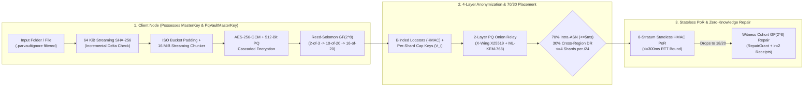

# ParVault (`parvault`, `parvault-seed` & `parvault-bench`)
### Zero-Knowledge, Post-Quantum, Erasure-Coded P2P Backup Daemon & Dedicated Seed Server

**[License: `AGPL-3.0-only`](LICENSE)** &bull; **Rust `2021` Edition** &bull; **[Targets: `x86_64` | `aarch64` static `musl`](#build--verification-commands)** &bull; **[Model-Checked: `6 TLA+ Protocol Specs & Stateright`](docs/SECURITY_AND_CRYPTOGRAPHY.md)**

`parvault` (library crate `parvault`, binaries `parvault`, `parvault-seed`, and `parvault-bench`) is a **zero-knowledge, post-quantum hybrid, Byzantine-resilient P2P backup and continuous folder-synchronization engine**.

Designed to run identically on multi-terabyte homelab NAS servers and memory-constrained residential gateways (`prplOS` / `OpenWrt` LXC containers with a strict **`< 32 MiB` active RAM ceiling**), `parvault` combines **16 MiB streaming `AES-256-GCM` + dual-cipher `PqVaultMasterKey` (`AES-256-GCM` + `ChaCha20-Poly1305`) cascaded encryption**, **Reed-Solomon erasure coding over $GF(2^8)$**, **4-layer shard anonymization ($\Omega_{\text{search}} \ge 2^{224}$)**, **Stateless Stratified Proof-of-Retrievability (PoR)**, and **Cryptographically Earned Uptime Tiers** so that **no storage peer, witness node, or DHT router is ever trusted with plaintext, metadata correlation, or unchecked shard concentration.**

---

## Documentation Hub (Choose Your Path)

| Guide | Audience | What's Inside |
| :--- | :--- | :--- |
| **[Homelab & Everyday User Quickstart (`QUICKSTART.md`)](QUICKSTART.md)** | **Homelabbers, Self-Hosters & Friend Co-Ops** | Plain-English (ELI15) overview and 5 copy-paste recipes (`identity`, `PersonalDeviceCert` linking, `.parvaultignore`, selective file restore, and 24-word "House Fire" recovery). |
| **[User & CLI Reference Manual (`docs/USER_AND_CLI_GUIDE.md`)](docs/USER_AND_CLI_GUIDE.md)** | **System Administrators & Power Users** | Complete CLI flag reference for `parvault` and `parvault-seed`, `PARVAULT-CERT-V1:` token workflows, `.parvaultignore` syntax, `config.toml` bandwidth rate limits, and bit-rot scrubbing. |
| **[Security & Cryptography Proofs (`docs/SECURITY_AND_CRYPTOGRAPHY.md`)](docs/SECURITY_AND_CRYPTOGRAPHY.md)** | **Cryptographers & Security Auditors** | Mathematical proofs, $\ge 2^{224}$ combinatorial anonymity bounds, NIST FIPS 203 `ML-KEM-768` & FIPS 204 `ML-DSA-65` hybrid combiners, 6 TLA+ formal specs, and live 13-container Docker P2P regression reports. |
| **[Architectural Decision Records (`docs/ADR.md`)](docs/ADR.md)** | **Distributed Systems Architects** | Complete engineering rationale across **`ADR-01` through `ADR-17`**. |
| **[AI Agent & Engineer Guide (`AGENTS.md`)](AGENTS.md)** | **Contributors & Coding Agents** | Module-by-module map of `src/`, the **7 Non-Negotiable Zero-Trust & Memory-Safety Rules**, and exact build/test/TLC verification commands. See also [`CONTRIBUTING.md`](CONTRIBUTING.md) and [`SECURITY.md`](SECURITY.md). |

---

## 60-Second Quickstart (`parvault` & `parvault-seed`)

```bash
# 1. Inspect your persistent node identity and Post-Quantum Owner Public Key
parvault identity

# 2. Preview and incrementally back up a folder (automatically honors .parvaultignore)
parvault diff-folder --folder ./documents
parvault watch-folder \
  --folder ./documents \
  --snapshot-out ./documents.manifest.bin \
  --seed-phrase "abandon abandon abandon abandon abandon abandon abandon abandon abandon abandon abandon about" \
  --vault-namespace "homelab-docs" \
  --catalog-out ./documents.catalog.bin \
  --prune-deleted \
  --once

# 3. Restore a single file (--file) or the entire directory tree
parvault restore-folder \
  --snapshot ./documents.manifest.bin \
  --out-dir ./restored-documents \
  --file "notes.txt"

# 4. Zero-Local-State "House Fire" Recovery (from 12/24-word BIP-39 seed phrase + encrypted catalog alone)
parvault recover-from-seed \
  --seed-phrase "abandon abandon abandon abandon abandon abandon abandon abandon abandon abandon abandon about" \
  --vault-namespace "homelab-docs" \
  --catalog-envelope ./documents.catalog.bin \
  --out-dir ./recovered-from-fire

# 5. Run a dedicated 24/7 Zero-Trust Homelab Seed Server on your NAS / Raspberry Pi
parvault-seed start \
  --mode homelab-vault \
  --data-dir /mnt/nas/parvault-seed \
  --max-gb 500 \
  --listen /ip4/0.0.0.0/tcp/4002
```

---

## Core Architecture at a Glance



| Capability | Cryptographic / Systems Mechanism | Governing ADR |
| :--- | :--- | :--- |
| **Bounded `< 32 MiB` Gateway RAM** | 64 KiB streaming SHA-256 delta checks + fixed 16 MiB streaming encryption & Reed-Solomon stripes | `ADR-01`, `ADR-16` |
| **Post-Quantum HNDL Immunity** | X-Wing `X25519 + ML-KEM-768` (FIPS 203), `Ed25519 + ML-DSA-65` (FIPS 204), and dual-cipher `PqVaultMasterKey` (`AES-256-GCM` + `ChaCha20-Poly1305`) | `ADR-12` |
| **4-Layer Shard Anonymization** | Keyed 256-bit `BlindedShardId` ($\Omega \ge 2^{224}$), per-shard capability keys $V_i$, ephemeral-issuer bearer quota vouchers, 2-layer PQ onion relay | `ADR-11` |
| **Elastic Day-1-to-10,000-User Scaling** | `PersonalDeviceCert` Day-1 ring (`2-of-3`), auto-draining `FoundationSeedAnchor`s, and earned `16-of-20` `HighUptimeAnchor` standing | `ADR-13`, `ADR-14` |
| **Byzantine & Red-Team Hardening** | Pre-decoding Merkle quarantine, bounded `with_limit` wire framing (`32 MiB`), atomic `fsync`+`rename`, path-traversal blocking, and BIP-39 12/24-word seed recovery | `ADR-09`, `ADR-15` |

---

## Embedding `parvault` as a Rust Library

Parent applications can embed `parvault` directly for incremental folder synchronization, post-quantum catalog sealing, and zero-local-state disaster recovery:

```rust
use parvault::{
    config::ErasureTier,
    crypto::{MasterKey, NodeIdentity},
    storage::{BlockStore, QuotaManager},
    sync::FolderSyncEngine,
};
use std::path::Path;

fn main() -> anyhow::Result<()> {
    // 1. Derive deterministic keys from a checksummed BIP-39 recovery seed phrase (or use MasterKey::generate())
    let seed = "abandon abandon abandon abandon abandon abandon abandon abandon abandon abandon abandon about";
    let namespace = "my-homelab-vault";
    let master_key = MasterKey::from_recovery_seed_phrase(seed, namespace);
    let owner_identity = NodeIdentity::from_recovery_seed_phrase(seed, namespace);

    // 2. Initialize crash-safe local BlockStore and incremental FolderSyncEngine
    let quota = QuotaManager::new(100 * 1024 * 1024 * 1024, 10 * 1024 * 1024 * 1024);
    let store = BlockStore::new(Path::new("./.parvault-data"), quota)?;
    let mut engine = FolderSyncEngine::new(
        store.clone(),
        master_key,
        owner_identity,
        ErasureTier::Homelab, // 16-of-20 Reed-Solomon over GF(2^8)
    );

    // 3. Incrementally encrypt & erasure-code new/modified files (respecting .parvaultignore)
    let snapshot = engine.sync_folder_once(Path::new("./my-folder"))?;
    let catalog = engine.export_encrypted_vault_catalog(seed, namespace, &snapshot)?;

    // 4. Zero-Local-State "House Fire" Recovery using only the seed phrase + encrypted catalog
    let restored_files = FolderSyncEngine::recover_folder_from_seed_phrase(
        store,
        seed,
        namespace,
        &catalog,
        Path::new("./restored-folder"),
    )?;
    println!("Verified and restored {restored_files} files!");
    Ok(())
}
```

---

## Empirical Benchmarks & Memory Telemetry (`parvault-bench`)

Measured via `cargo run --release --bin parvault-bench -- run --payload-mib 64` (zero simulated sleeps or fabricated numbers; Linux `/proc/self/status` `VmRSS` & `VmHWM` + wall-clock timing):

| Measurement Checkpoint (`64 MiB` File = `4 x 16 MiB` Stripes) | `VmRSS` (Active Resident) | `VmHWM` (Peak Working Set) | Streaming Throughput |
| :--- | :---: | :---: | :---: |
| **Process Baseline (Startup)** | `4.16 MiB` (`4,256 KiB`) | `4.16 MiB` (`4,256 KiB`) | — |
| **After `64 MiB` 64 KiB-Chunked File Setup** | `4.34 MiB` (`4,448 KiB`) | `4.34 MiB` (`4,448 KiB`) | — |
| **After `store_file_streaming` (`4 x 16 MiB`, `16-of-20`)** | **`5.74 MiB` (`+1.58 MiB` delta)** | `74.63 MiB` ($\mathcal{O}(1)$ 1-stripe buffers) | **`248.9 MiB/s`** |
| **After `restore_file_streaming` + SHA-256 Verify** | **`5.80 MiB` (`+1.64 MiB` delta)** | `74.63 MiB` ($\mathcal{O}(1)$ 1-stripe buffers) | **`317.1 MiB/s`** |

| Subsystem / Operation | Parameters / Construction | Measured Throughput / Latency |
| :--- | :--- | :---: |
| **`Argon2id` + `HKDF-SHA256` Seed Derivation** | `m = 64 MiB (65,536 KiB), t = 3, p = 4` (BIP-39 12-word) | **`98.45 ms`** |
| **`AES-256-GCM` Stripe Encryption / Decryption** | `16 MiB` stripe + HKDF per-purpose subkey/nonce | **`1,181.9 MiB/s` / `1,153.3 MiB/s`** |
| **`PqVaultMasterKey` Dual-Cipher Encrypt / Decrypt** | `16 MiB` (`AES-256-GCM` inner + `ChaCha20-Poly1305` outer) | **`602.4 MiB/s` / `636.0 MiB/s`** |
| **`HybridKemKeypair` Encapsulate / Decapsulate (X-Wing)** | `X25519 + NIST FIPS 203 ML-KEM-768` (`HKDF-SHA512`) | **`86.6 us` / `89.3 us`** |
| **`HybridPqSigningKeypair` Sign / Verify** | `Ed25519 + NIST FIPS 204 ML-DSA-65` | **`408.4 us` / `140.7 us`** |
| **Reed-Solomon $GF(2^8)$ `Consumer (10-of-20)` Encode / 4-Erasure Reconstruct** | `16 MiB` stripe $\to$ `20 x 1.6 MiB` shards + Merkle quarantine | **`302.5 MiB/s` / `242.7 MiB/s`** |
| **Reed-Solomon $GF(2^8)$ `Homelab (16-of-20)` Encode / 4-Erasure Reconstruct** | `16 MiB` stripe $\to$ `20 x 1.0 MiB` shards + Merkle quarantine | **`616.2 MiB/s` / `359.0 MiB/s`** |

---

## Build & Verification Commands

```bash
# Run all unit, integration, mathematical proof, Stateright, TLA+ TLC, and live libp2p TCP test suites
cargo test --release

# Execute the empirical cryptography, Reed-Solomon, and /proc/self/status memory benchmark suite
cargo run --release --bin parvault-bench -- run --payload-mib 64

# Execute the built-in end-to-end verification of parvault-seed (homelab-vault + public-bootstrap)
cargo run --release --bin parvault-seed -- self-test

# Execute the 13-container live Docker P2P regression & disaster recovery gate (Stages 1-10)
bash scripts/docker_acceptance_gate.sh

# Build zero-dependency static Linux musl binaries (x86_64 and ARM64)
cargo build --release --target x86_64-unknown-linux-musl
CARGO_TARGET_AARCH64_UNKNOWN_LINUX_MUSL_LINKER=aarch64-linux-gnu-gcc \
  cargo build --release --target aarch64-unknown-linux-musl
```

---

## License

Licensed under the **GNU Affero General Public License v3.0 only (`AGPL-3.0-only`)**. See [`LICENSE`](LICENSE) for the full verbatim license text.
