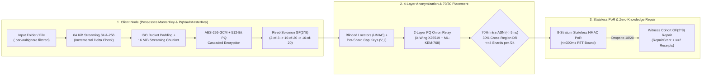

# ParVault (`parvault`, `parvault-seed` & `parvault-bench`)
### Zero-Knowledge, Post-Quantum, Erasure-Coded P2P Backup Daemon & Dedicated Seed Server

**[License: `AGPL-3.0-only`](LICENSE)** &bull; **Rust `2021` Edition** &bull; **[Targets: `x86_64` | `aarch64` static `musl`](#build--verification-commands)** &bull; **[Model-Checked: `6 TLA+ Protocol Specs & Stateright`](docs/SECURITY_AND_CRYPTOGRAPHY.md)**

`parvault` (library crate `parvault`, binaries `parvault`, `parvault-seed`, and `parvault-bench`) is a **zero-knowledge, post-quantum hybrid, Byzantine-resilient P2P backup and continuous folder-synchronization engine** — essentially **"Filecoin without the coin"**, preserving the genuine distributed storage systems engineering (erasure coding, stateless Proof-of-Retrievability, symmetric Byte-Epoch reciprocity, zero-knowledge encryption) while eliminating 100% of cryptocurrency tokens, wallets, gas fees, and blockchain bloat so it runs inside **`9.39 MiB` RAM on a home router**.

Designed to run identically on multi-terabyte homelab NAS servers and memory-constrained residential gateways (`prplOS` / `OpenWrt` LXC containers with a strict **`< 32 MiB` active RAM ceiling**), `parvault` combines **16 MiB streaming `AES-256-GCM` + dual-cipher `PqVaultMasterKey` (`AES-256-GCM` + `ChaCha20-Poly1305`) cascaded encryption**, **Reed-Solomon erasure coding over $GF(2^8)$**, **4-layer shard anonymization ($\Omega_{\text{search}} \ge 2^{224}$)**, **Stateless Stratified Proof-of-Retrievability (PoR)**, and **Cryptographically Earned Uptime Tiers** so that **no storage peer, witness node, or DHT router is ever trusted with plaintext, metadata correlation, or unchecked shard concentration.**

---

## Documentation Hub (Choose Your Path)

| Guide | Audience | What's Inside |
| :--- | :--- | :--- |
| **[Homelab & Everyday User Quickstart (`QUICKSTART.md`)](QUICKSTART.md)** | **Homelabbers, Self-Hosters & Friend Co-Ops** | Plain-English (ELI15) overview and 5 copy-paste recipes (`parvault init`, `parvault up`, zero-IP `discover`, 4-word `join`, and 24-word "House Fire" recovery). |
| **[Router SoC Hardware & Firmware Integration Guide (`docs/ROUTER_SOC_HARDWARE_GUIDE.md`)](docs/ROUTER_SOC_HARDWARE_GUIDE.md)** | **Router Vendors, OpenWrt & prplOS Integrators** | Turnkey integration for MediaTek Filogic / Rockchip / x86_64 routers: memory/flash budgets, `procd` init scripts, LXC manifests, and embedded status dashboards. |
| **[User & CLI Reference Manual (`docs/USER_AND_CLI_GUIDE.md`)](docs/USER_AND_CLI_GUIDE.md)** | **System Administrators & Power Users** | Complete CLI flag reference for `parvault` and `parvault-seed`, `PARVAULT-CERT-V1:` token workflows, `.parvaultignore` syntax, `config.toml` bandwidth rate limits, and bit-rot scrubbing. |
| **[Security & Cryptography Proofs (`docs/SECURITY_AND_CRYPTOGRAPHY.md`)](docs/SECURITY_AND_CRYPTOGRAPHY.md)** | **Cryptographers & Security Auditors** | Mathematical proofs, $\ge 2^{224}$ combinatorial anonymity bounds, NIST FIPS 203 `ML-KEM-768` & FIPS 204 `ML-DSA-65` hybrid combiners, 6 TLA+ formal specs, and live 13-container Docker P2P regression reports. |
| **[Architectural Decision Records (`docs/ADR.md`)](docs/ADR.md)** | **Distributed Systems Architects** | Complete engineering rationale across **`ADR-01` through `ADR-19`**. |
| **[AI Agent & Engineer Guide (`AGENTS.md`)](AGENTS.md)** | **Contributors & Coding Agents** | Module-by-module map of `src/`, the **7 Non-Negotiable Zero-Trust & Memory-Safety Rules**, and exact build/test/TLC verification commands. See also [`CONTRIBUTING.md`](CONTRIBUTING.md) and [`SECURITY.md`](SECURITY.md). |

---

## 60-Second Quickstart (Zero-IP Home Network & Cloud-NAS)

```bash
# 1. Initialize your vault with a 24-word BIP-39 recovery mnemonic
parvault init --profile router-soc --watch /mnt/usb-nas/shared --label "Router-NAS"

# 2. Launch turnkey Cloud-NAS appliance mode on your router or home server
parvault up \
  --profile router-soc \
  --folder /mnt/usb-nas/shared \
  --status-http 0.0.0.0:4080 \
  --pair

# 3. On your laptop: auto-discover home LAN storage (Zero IP addresses to type!)
parvault discover

# 4. Pair permanently with the 4-word code displayed on your router
parvault join --code shield-copper-alpine-matrix

# 5. Incrementally back up files (auto-finds paired router storage with zero --peers flags!)
parvault watch-folder --folder ~/Documents --once

# 6. Or join the open Public Commons swarm with zero pairing (BitTorrent-style public tracker):
parvault watch-folder --folder ~/Documents --public --tracker /dns4/tracker.neighborhoodcloud.org/tcp/4002/p2p/... --once
```

---

## Core Architecture at a Glance



| Capability | Cryptographic / Systems Mechanism | Governing ADR |
| :--- | :--- | :--- |
| **Bounded `< 32 MiB` Gateway RAM** | 64 KiB streaming SHA-256 delta checks + fixed 16 MiB streaming encryption & Reed-Solomon stripes | `ADR-01`, `ADR-16` |
| **Router-SoC 1 MiB Profile** | Configurable 1 MiB stripes (`SOC_ROUTER_STRIPE_SIZE_BYTES`), `5.83–7.45 MiB` stripped static `musl` binary (`soc` profile), `19.6 MB` (`6.13 MB` compressed) `FROM scratch` container, `9.36–9.39 MiB` peak `VmHWM` inside a 32–48 MiB cgroup | `ADR-18` |
| **Zero-IP Home LAN & 4-Word Pairing** | Signed UDP beacons (port `4009`), 4-word BIP-39 SAS pairing, DHCP auto-healing in `known_peers.json` | `ADR-18` |
| **Online WAN Rendezvous & DDNS** | STUN-over-Noise address reflection, blinded rendezvous mailbox, dynamic-IP presence across ISP rotations | `ADR-18` |
| **Public Commons Swarm Mode** | Zero-pairing BitTorrent-style public tracker (`--public`), self-signed Hashcash PoW (`PublicCommonsTicket`) | `ADR-18` |
| **Post-Quantum HNDL Immunity** | X-Wing `X25519 + ML-KEM-768` (FIPS 203), `Ed25519 + ML-DSA-65` (FIPS 204), and dual-cipher `PqVaultMasterKey` (`AES-256-GCM` + `ChaCha20-Poly1305`) | `ADR-12` |
| **4-Layer Shard Anonymization** | Keyed 256-bit `BlindedShardId` ($\Omega \ge 2^{224}$), per-shard capability keys $V_i$, ephemeral-issuer bearer quota vouchers, 2-layer PQ onion relay | `ADR-11` |
| **Elastic Day-1-to-10,000-User Scaling** | `PersonalDeviceCert` Day-1 ring (`2-of-3`), auto-draining `FoundationSeedAnchor`s, and earned `16-of-20` `HighUptimeAnchor` standing | `ADR-13`, `ADR-14` |
| **Byzantine & Red-Team Hardening** | Pre-decoding Merkle quarantine, bounded `with_limit` wire framing (`32 MiB`), atomic `fsync`+`rename`, path-traversal blocking, and BIP-39 12/24-word seed recovery | `ADR-09`, `ADR-15` |
| **Privacy-Preserving Eviction Engine** | 4-vector bad-actor/content eviction (`parvault evict`), zero plaintext IPs on disk (`eviction_index.bin` HMAC tags), multi-pass `0x00` shredding, $M$-of-$N$ Public Tracker Council quorum (`cosign-eviction`), cryptographic reporter burden-of-proof (`parvault report-abuse`) | `ADR-19` |

---

## Embedding `parvault` as a Rust Library

Parent applications can embed `parvault` directly for incremental folder synchronization, post-quantum catalog sealing, and zero-local-state disaster recovery:

```rust
use parvault::{
    config::ErasureTier,
    crypto::{MasterKey, NodeIdentity},
    storage::{BlockStore, QuotaManager},
    sync::FolderSyncEngine,
};
use std::path::Path;

fn main() -> anyhow::Result<()> {
    // 1. Derive deterministic keys from a checksummed BIP-39 recovery seed phrase (or use MasterKey::generate())
    let seed = "abandon abandon abandon abandon abandon abandon abandon abandon abandon abandon abandon about";
    let namespace = "my-homelab-vault";
    let master_key = MasterKey::from_recovery_seed_phrase(seed, namespace);
    let owner_identity = NodeIdentity::from_recovery_seed_phrase(seed, namespace);

    // 2. Initialize crash-safe local BlockStore and incremental FolderSyncEngine
    let quota = QuotaManager::new(100 * 1024 * 1024 * 1024, 10 * 1024 * 1024 * 1024);
    let store = BlockStore::new(Path::new("./.parvault-data"), quota)?;
    let mut engine = FolderSyncEngine::new(
        store.clone(),
        master_key,
        owner_identity,
        ErasureTier::Homelab, // 16-of-20 Reed-Solomon over GF(2^8)
    );

    // 3. Incrementally encrypt & erasure-code new/modified files (respecting .parvaultignore)
    let snapshot = engine.sync_folder_once(Path::new("./my-folder"))?;
    let catalog = engine.export_encrypted_vault_catalog(seed, namespace, &snapshot)?;

    // 4. Zero-Local-State "House Fire" Recovery using only the seed phrase + encrypted catalog
    let restored_files = FolderSyncEngine::recover_folder_from_seed_phrase(
        store,
        seed,
        namespace,
        &catalog,
        Path::new("./restored-folder"),
    )?;
    println!("Verified and restored {restored_files} files!");
    Ok(())
}
```

---

## Empirical Benchmarks & Memory Telemetry (`parvault-bench`)

Measured via `cargo run --release --bin parvault-bench -- run --payload-mib 64` (zero simulated sleeps or fabricated numbers; Linux `/proc/self/status` `VmRSS` & `VmHWM` + wall-clock timing):

### Streaming Memory Footprint & Throughput (Dual Profile Comparison)

| Profile | Stripe Size | Stripes | Baseline RSS | Peak VmHWM | SoC < 32 MiB Gate | Store Speed | Restore Speed |
| :--- | :---: | :---: | :---: | :---: | :---: | :---: | :---: |
| **Router-SoC** | `1 MiB` | `64` | `4.12 MiB` | **`9.39 MiB`** (`9,616 KiB`) | **PASS (< 32 MiB)** | **`78.8 MiB/s`** | **`117.8 MiB/s`** |
| **Desktop / Homelab-NAS** | `16 MiB` | `4` | `5.44 MiB` | **`57.30 MiB`** (`58,676 KiB`) | Desktop Target | **`118.1 MiB/s`** | **`104.8 MiB/s`** |

| Subsystem / Operation | Parameters / Construction | Measured Throughput / Latency |
| :--- | :--- | :---: |
| **`Argon2id` + `HKDF-SHA256` Seed Derivation** | `m = 64 MiB (65,536 KiB), t = 3, p = 4` (BIP-39 12-word) | **`156.44 ms`** |
| **`AES-256-GCM` Stripe Encryption (Router-SoC)** | `1 MiB` stripe + HKDF per-purpose subkey/nonce | **`522.1 MiB/s`** |
| **`AES-256-GCM` Stripe Decryption (Router-SoC)** | `1 MiB` stripe + tag verification | **`535.0 MiB/s`** |
| **`AES-256-GCM` Stripe Encryption (Desktop)** | `16 MiB` stripe + HKDF per-purpose subkey/nonce | **`465.9 MiB/s`** |
| **`AES-256-GCM` Stripe Decryption (Desktop)** | `16 MiB` stripe + tag verification | **`459.0 MiB/s`** |
| **`PqVaultMasterKey` Dual-Cipher Encryption** | `16 MiB` (`AES-256-GCM` inner + `ChaCha20-Poly1305` outer) | **`247.5 MiB/s`** |
| **`PqVaultMasterKey` Dual-Cipher Decryption** | `16 MiB` (`ChaCha20-Poly1305` outer + `AES-256-GCM` inner) | **`250.4 MiB/s`** |
| **`HybridKemKeypair` Encapsulate / Decapsulate (X-Wing)** | `X25519 + NIST FIPS 203 ML-KEM-768` (`HKDF-SHA512`) | **`100.2 us` / `108.2 us`** |
| **`HybridPqSigningKeypair` Sign / Verify** | `Ed25519 + NIST FIPS 204 ML-DSA-65` | **`515.3 us` / `167.9 us`** |
| **Reed-Solomon $GF(2^8)$ `Router-SoC (16-of-20)` Encode / Reconstruct** | `1 MiB` stripe $\to$ `20 x 64 KiB` shards + Merkle quarantine | **`311.9 MiB/s` / `140.4 MiB/s`** |
| **Reed-Solomon $GF(2^8)$ `Consumer (10-of-20)` Encode / Reconstruct** | `16 MiB` stripe $\to$ `20 x 1.6 MiB` shards + Merkle quarantine | **`142.7 MiB/s` / `83.6 MiB/s`** |
| **Reed-Solomon $GF(2^8)$ `Homelab (16-of-20)` Encode / Reconstruct** | `16 MiB` stripe $\to$ `20 x 1.0 MiB` shards + Merkle quarantine | **`258.5 MiB/s` / `132.2 MiB/s`** |

---

## Build & Verification Commands

```bash
# Run all unit, integration, mathematical proof, Stateright, TLA+ TLC, and live libp2p TCP test suites
cargo test --release

# Execute the empirical cryptography, Reed-Solomon, and /proc/self/status memory benchmark suite
cargo run --release --bin parvault-bench -- run --payload-mib 64

# Execute the built-in end-to-end verification of parvault-seed (homelab-vault + public-bootstrap)
cargo run --release --bin parvault-seed -- self-test

# Execute the 13-container live Docker P2P regression & disaster recovery gate (Stages 1-10)
bash scripts/docker_acceptance_gate.sh

# Build zero-dependency static Linux musl binaries (x86_64 and ARM64)
cargo build --release --target x86_64-unknown-linux-musl
CARGO_TARGET_AARCH64_UNKNOWN_LINUX_MUSL_LINKER=aarch64-linux-gnu-gcc \
  cargo build --release --target aarch64-unknown-linux-musl
```

---

## License

Licensed under the **GNU Affero General Public License v3.0 only (`AGPL-3.0-only`)**. See [`LICENSE`](LICENSE) for the full verbatim license text.
