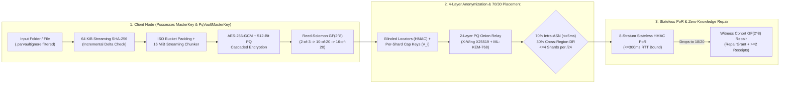

# ParVault (`parvault`, `parvault-seed`, `parvault-gateway`, `parvault-fuse` & `parvault-bench`)
### Zero-Knowledge, Post-Quantum, Erasure-Coded P2P Storage Engine, Zero-Filesystem Seed Server & Zero-Copy UDS Gateway (`v0.4.0`)

**[License: `AGPL-3.0-only`](LICENSE)** &bull; **Rust `2021` Edition** &bull; **[Targets: `x86_64` | `aarch64` static `musl`](#build--verification-commands)** &bull; **[Model-Checked: `15 Kani Bounded Model Checking Harnesses + 7 TLA+ Specs`](docs/SAFETY_AND_LINT_AUDIT.md)**

`parvault` (library crate `parvault`, binaries `parvault`, `parvault-seed`, `parvault-gateway`, `parvault-fuse`, and `parvault-bench`) is a **zero-knowledge, post-quantum hybrid, Byzantine-resilient P2P backup, zero-copy local gateway, and lazy-streaming virtual filesystem engine** — essentially **"Filecoin without the coin"**, preserving genuine distributed storage systems engineering (erasure coding, stateless Proof-of-Retrievability, symmetric Byte-Epoch reciprocity, zero-knowledge encryption, `memfd` `SCM_RIGHTS` zero-copy IPC, and sub-millisecond Macaroon capabilities) while eliminating 100% of cryptocurrency tokens, wallets, gas fees, and blockchain bloat so it runs inside **`9.72 MiB` RAM on a home router**.

> [!TIP]
> **Clean Architectural Separation (`v0.4.0`):**
> - **`parvault` (this repository, `AGPL-3.0-only`):** Pure UNIX core daemons (`parvault`, `parvault-seed --no-fs`, `parvault-gateway` on `/var/run/parvault.sock`, and optional `parvault-fuse` lazy VFS behind `--features vfs`), post-quantum cryptography, $GF(2^8)$ Reed-Solomon sharding, HMAC-SHA256 `CapabilityMacaroon` attenuation, and formal verification (`cargo kani` + `7` TLA+ TLC specs).
> - **Downstream Companion Appliances (`parvault-suite` & `parvault-control`):** High-level consumer/ISP daemons (`parvault-auth-broker`, `parvault-media-daemon`, `parvault-isp-agent`) and the Air-Gapped Hardware Operator Control Plane (`parvault-control`) connect strictly over `/var/run/parvault.sock` (`SCM_RIGHTS` `memfd` zero-copy IPC) and `admin_rpc` without bloating the core binaries.

Designed to run identically on multi-terabyte homelab NAS servers and memory-constrained residential gateways (`prplOS` / `OpenWrt` LXC containers with a strict **`< 32 MiB` active RAM ceiling**), `parvault` combines **16 MiB streaming `AES-256-GCM` + dual-cipher `PqVaultMasterKey` (`AES-256-GCM` + `ChaCha20-Poly1305`) cascaded encryption**, **Reed-Solomon erasure coding over $GF(2^8)$**, **4-layer shard anonymization ($\Omega_{\text{search}} \ge 2^{224}$)**, **Stateless Stratified Proof-of-Retrievability (PoR)**, and **Cryptographically Earned Uptime Tiers** so that **no storage peer, witness node, or DHT router is ever trusted with plaintext, metadata correlation, or unchecked shard concentration.**

> [!NOTE]
> **Public Tracker Status:** We are **not** currently operating an official public tracker or public bootstrap swarm. **All `parvault` features work standalone without a public tracker** — including Zero-IP home LAN auto-discovery (`UDP 4009`), 4-word SAS pairing (`parvault pair` / `parvault join`), Router-SoC Cloud-NAS mode (`--profile router-soc`), personal multi-machine rings, and private self-hosted `parvault-seed` rendezvous/vault servers for friends, family, or organizations.
>
> **Public Swarm Readiness:** The codebase is engineered with multiple subsystems specifically designed to initialize and govern a public tracker (`parvault-seed --mode public-bootstrap`) when desired — including memory-hard Argon2id & Hashcash Sybil PoW (`PublicCommonsTicket`), Web-of-Trust (`WoT`) vouching & 1-strike Byzantine slashing, earned storage reciprocity tiers, 4-vector privacy-preserving keyed-HMAC eviction (`ADR-19`), $M$-of-$N$ federated council co-signing, and zero-private-key-on-VPS `admin_rpc` hooks.

---

## Documentation Hub (Choose Your Path)

| Guide | Audience | What's Inside |
| :--- | :--- | :--- |
| **[Homelab & Everyday User Quickstart (`QUICKSTART.md`)](QUICKSTART.md)** | **Homelabbers, Self-Hosters & Friend Co-Ops** | Plain-English (ELI15) overview and 5 copy-paste recipes (`parvault init`, `parvault up`, zero-IP `discover`, 4-word `join`, and 24-word "House Fire" recovery). |
| **[Router SoC Hardware & Firmware Integration Guide (`docs/ROUTER_SOC_HARDWARE_GUIDE.md`)](docs/ROUTER_SOC_HARDWARE_GUIDE.md)** | **Router Vendors, OpenWrt & prplOS Integrators** | Turnkey integration for MediaTek Filogic / Rockchip / x86_64 routers: memory/flash budgets, `procd` init scripts, LXC manifests, and embedded status dashboards. |
| **[Rust Library Embedding Guide (`docs/EMBEDDING.md`)](docs/EMBEDDING.md)** | **Rust Application & Firmware Developers** | Embedding `parvault` as a library crate: BIP-39 deterministic keys, `FolderSyncEngine`, `RouterSoc` vs. `Desktop` memory profiles, and `admin_rpc` wire hooks. |
| **[Empirical Benchmarks & Memory Telemetry (`docs/BENCHMARKS.md`)](docs/BENCHMARKS.md)** | **Systems Engineers & Evaluators** | Reproducible `parvault-bench` throughput, `/proc/self/status` `VmHWM` (`9.72 MiB` Router-SoC; `10.98 MiB` `parvault-gateway`), static `musl` binary footprints (`2.88–7.52 MiB`), and 14-container `48m` cgroup results. |
| **[Memory Safety, OS-FFI & Lint Audit (`docs/SAFETY_AND_LINT_AUDIT.md`)](docs/SAFETY_AND_LINT_AUDIT.md)** | **Security & Rust Safety Auditors** | `#![deny(unsafe_code)]` / `#![forbid(unsafe_code)]` posture, complete `src/os_sys.rs` POSIX syscall `SAFETY` proof table, and full `#[allow(...)]` lint-suppression justification table. |
| **[User & CLI Reference Manual (`docs/USER_AND_CLI_GUIDE.md`)](docs/USER_AND_CLI_GUIDE.md)** | **System Administrators & Power Users** | Complete CLI flag reference for `parvault` and `parvault-seed`, `PARVAULT-CERT-V1:` token workflows, `.parvaultignore` syntax, `config.toml` bandwidth rate limits, and bit-rot scrubbing. |
| **[Security & Cryptography Proofs (`docs/SECURITY_AND_CRYPTOGRAPHY.md`)](docs/SECURITY_AND_CRYPTOGRAPHY.md)** | **Cryptographers & Security Auditors** | Mathematical proofs, $\ge 2^{224}$ combinatorial anonymity bounds, NIST FIPS 203 `ML-KEM-768` & FIPS 204 `ML-DSA-65` hybrid combiners, 15 Kani symbolic harnesses, 7 TLA+ formal specs, and live Docker P2P regression reports. |
| **[Architectural Decision Records (`docs/ADR.md` & `docs/adr/`)](docs/ADR.md)** | **Distributed Systems Architects** | Master ADR Index, Active `v0.4.0` Cryptographic Suite Guide (`AES-256-GCM` vs. Post-Quantum), and **31 single-concern ADRs (`ADR-01` – `ADR-31`)** in [`docs/adr/`](docs/adr/). |
| **[AI Agent & Engineer Guide (`AGENTS.md`)](AGENTS.md)** | **Contributors & Coding Agents** | Module-by-module map of `src/`, the **7 Non-Negotiable Zero-Trust & Memory-Safety Rules**, and exact build/test/TLC verification commands. See also [`CONTRIBUTING.md`](CONTRIBUTING.md) and [`SECURITY.md`](SECURITY.md). |

---

## 60-Second Quickstart (Zero-IP Home Network & Cloud-NAS)

```bash
# 1. Initialize your vault with a 24-word BIP-39 recovery mnemonic
parvault init --profile router-soc --watch /mnt/usb-nas/shared --label "Router-NAS"

# 2. Launch turnkey Cloud-NAS appliance mode on your router or home server
parvault up \
  --profile router-soc \
  --folder /mnt/usb-nas/shared \
  --status-http 0.0.0.0:4080 \
  --pair

# 3. On your laptop: auto-discover home LAN storage (Zero IP addresses to type!)
parvault discover

# 4. Pair permanently with the 4-word code displayed on your router
parvault join --code shield-copper-alpine-matrix

# 5. Incrementally back up files (auto-finds paired router storage with zero --peers flags!)
parvault watch-folder --folder ~/Documents --once

# 6. Optional: connect to a self-hosted or community-initialized public tracker (--public):
#    (No official public tracker is currently hosted; supply your own parvault-seed multiaddr)
parvault watch-folder --folder ~/Documents --public --tracker /ip4/<YOUR_SEED_IP>/tcp/4002/p2p/<SEED_PEER_ID> --once
```

---

## Core Architecture at a Glance



| Capability | Cryptographic / Systems Mechanism | Governing ADR |
| :--- | :--- | :--- |
| **Bounded `< 32 MiB` Gateway RAM** | 64 KiB streaming SHA-256 delta checks + fixed 16 MiB streaming encryption & Reed-Solomon stripes | `ADR-01`, `ADR-16` |
| **Router-SoC 1 MiB Profile** | Configurable 1 MiB stripes (`ROUTER_SOC_STRIPE_SIZE_BYTES`), `2.88–5.89 MiB` (`aarch64`) / `3.62–7.52 MiB` (`x86_64`) stripped static `musl` binaries (`soc` profile), `19.6 MB` (`6.13 MB` compressed) `FROM scratch` container, `9.72–9.74 MiB` peak `VmHWM` inside a 32–48 MiB cgroup | `ADR-18` |
| **Zero-IP Home LAN & 4-Word Pairing** | Signed UDP beacons (port `4009`), 4-word BIP-39 SAS pairing, DHCP auto-healing in `known_peers.json` | `ADR-18` |
| **Online WAN Rendezvous & DDNS** | STUN-over-Noise address reflection, blinded rendezvous mailbox, dynamic-IP presence across ISP rotations | `ADR-18` |
| **Public Commons Swarm Mode** | Zero-pairing BitTorrent-style public tracker (`--public`), self-signed Hashcash PoW (`PublicCommonsTicket`) | `ADR-18` |
| **Post-Quantum HNDL Immunity** | X-Wing `X25519 + ML-KEM-768` (FIPS 203), `Ed25519 + ML-DSA-65` (FIPS 204), and dual-cipher `PqVaultMasterKey` (`AES-256-GCM` + `ChaCha20-Poly1305`) | `ADR-12` |
| **4-Layer Shard Anonymization** | Keyed 256-bit `BlindedShardId` ($\Omega \ge 2^{224}$), per-shard capability keys $V_i$, ephemeral-issuer bearer quota vouchers, 2-layer PQ onion relay | `ADR-11` |
| **Elastic Day-1-to-10,000-User Scaling** | `PersonalDeviceCert` Day-1 ring (`2-of-3`), auto-draining `FoundationSeedAnchor`s, and earned `16-of-20` `HighUptimeAnchor` standing | `ADR-13`, `ADR-14` |
| **Byzantine & Red-Team Hardening** | Pre-decoding Merkle quarantine, bounded `with_limit` wire framing (`32 MiB`), atomic `fsync`+`rename`, path-traversal blocking, and BIP-39 12/24-word seed recovery | `ADR-09`, `ADR-15` |
| **Privacy-Preserving Eviction Engine** | 4-vector bad-actor/content eviction (`parvault evict`), zero plaintext IPs on disk (`eviction_index.bin` HMAC tags), multi-pass `0x00` shredding, $M$-of-$N$ Public Tracker Council quorum (`cosign-eviction`), cryptographic reporter burden-of-proof (`parvault report-abuse`) | `ADR-19` |
| **Zero-Filesystem Bounded RAM Mode (`parvault-seed --no-fs`)** | Pure in-memory seed/bootstrap execution (`--no-fs --in-memory-mb <MiB>`, `--identity-env` / `--identity-file`) with **zero persistent directories or files** created, hard RAM byte-cap enforcement, and `0x00` `zeroize()` memory wiping on eviction/drop | [`ADR-30`](docs/adr/ADR-30-filesystem-free-in-memory-seed-mode.md) |
| **Zero-Copy UDS Gateway & Macaroon Capabilities (`parvault-gateway`)** | `/var/run/parvault.sock` Unix Domain Socket server passing Linux `memfd_create` descriptors via `SCM_RIGHTS` (`10.98 MiB` `VmHWM` streaming `64+ MiB`, `40`-lane `128 KiB`-stack single-wave TTFB pool), enforced in `< 1 ms` RAM by HMAC-SHA256 `CapabilityMacaroon` caveats (`AllowedManifest`, `ByteRange`, `ExpiresAtUnixMs`, `ReadOnly`) | [`ADR-27`](docs/adr/ADR-27-zero-copy-uds-gateway-and-hedged-pool.md), [`ADR-28`](docs/adr/ADR-28-stateless-macaroon-capability-attenuation.md) |
| **Lazy-Streaming Virtual File System (`parvault-fuse`)** | Feature-gated (`--features vfs`) pure-Rust `/dev/fuse` (`ABI 7.31`, `0` `unsafe`) + unprivileged HTTP `206 Partial Content` & WebDAV `PROPFIND` server fetching targeted `1 MiB` stripes on demand (`14.59 ms` TTFB `< 50 ms` on `10 GiB` sparse vaults) with bounded `LruBlockCache` eviction | [`ADR-29`](docs/adr/ADR-29-pure-rust-fuse-and-webdav-lazy-vfs.md) |
| **Machine-Checked Formal Verification (`cargo kani` + `7` TLA+ Specs)** | **15 Kani Rust Bounded Model Checking symbolic harnesses** (`src/kani_proofs.rs`, `aes.rs`, `reed_solomon.rs`) + **7 exhaustive TLA+ TLC specifications** (`specs/*.tla`, `4,467` distinct states, `0` errors) + `#![deny(unsafe_code)]` / `#![forbid(unsafe_code)]` | [`ADR-31`](docs/adr/ADR-31-unsafe-remediation-and-os-sys-ffi-boundary.md), [`ADR-01`–`ADR-31`](docs/ADR.md) |

---

## Build & Verification Commands

```bash
# Run all 122 unit, integration, mathematical proof, Stateright, TLA+ TLC, UDS zero-copy IPC & VFS tests
TLA2TOOLS_JAR=/root/tla2tools.jar cargo test --release

# Run all 15 Kani Rust Bounded Model Checking symbolic harnesses + all 7 TLA+ TLC specifications
bash scripts/verify_formal_proofs.sh

# Execute built-in end-to-end self-tests for seed, zero-copy IPC gateway, and lazy VFS daemons
cargo run --release --bin parvault-seed -- self-test
cargo run --release --bin parvault-gateway -- self-test
cargo run --release --bin parvault-fuse -- self-test

# Launch a zero-filesystem, RAM-capped seed node (zero directories or files created on disk)
parvault-seed start --no-fs --in-memory-mb 256 --mode public-bootstrap --listen /ip4/0.0.0.0/tcp/4002

# Launch the zero-copy Unix Domain Socket gateway and mount a lazy-streaming virtual filesystem
parvault-gateway --socket /var/run/parvault.sock --data-dir ~/.parvault-gw serve
parvault-fuse --socket /var/run/parvault.sock --cache-dir /tmp/pv-cache --cache-mib 512 webdav --listen 127.0.0.1:8088

# Execute the empirical cryptography, Reed-Solomon, and /proc/self/status memory benchmark suite (see docs/BENCHMARKS.md)
cargo run --release --bin parvault-bench -- run --payload-mib 64

# Execute the 14-container live Docker P2P & 48 MiB Router-SoC acceptance gate (Stages 1-12)
bash scripts/docker_acceptance_gate.sh

# Build stripped zero-dependency static Linux musl binaries (--profile soc: ARM64 2.88-5.89 MiB, x86_64 3.62-7.52 MiB)
cargo build --profile soc --target x86_64-unknown-linux-musl \
  --bin parvault --bin parvault-seed --bin parvault-gateway --bin parvault-fuse
CARGO_TARGET_AARCH64_UNKNOWN_LINUX_MUSL_LINKER=aarch64-linux-gnu-gcc \
  cargo build --profile soc --target aarch64-unknown-linux-musl \
  --bin parvault --bin parvault-seed --bin parvault-gateway --bin parvault-fuse
```

---

## License

Licensed under the **GNU Affero General Public License v3.0 only (`AGPL-3.0-only`)**. See [`LICENSE`](LICENSE) for the full verbatim license text.
