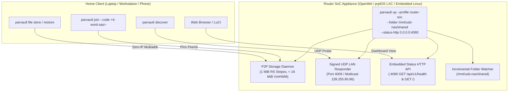
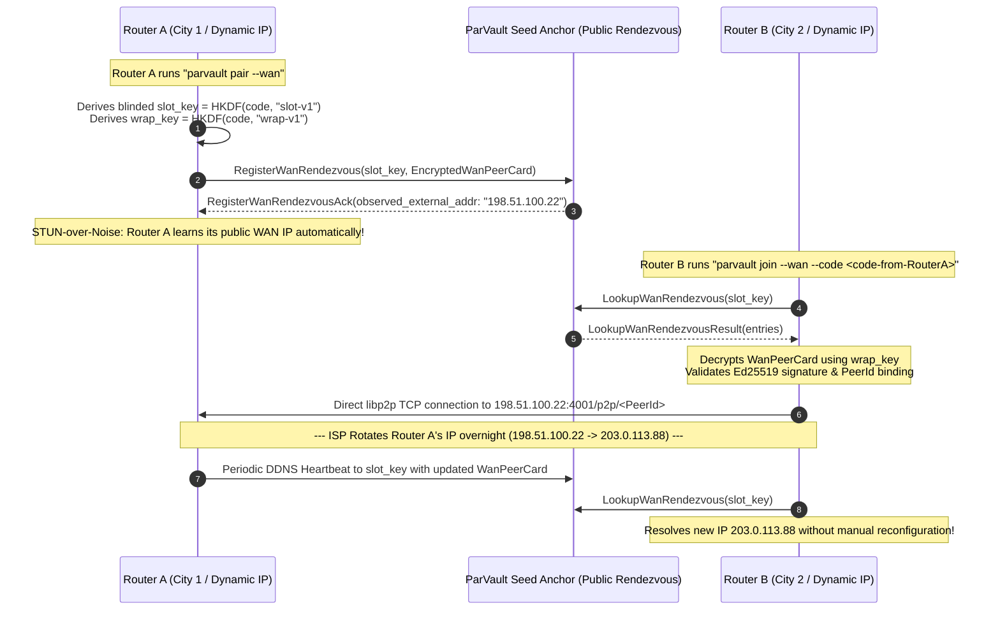

# ParVault Router SoC Hardware & Firmware Integration Guide
### Building Zero-Trust Cloud-NAS & Neighborhood Cloud Appliances on OpenWrt, prplOS, and ARM64 / x86_64 Gateway Routers

**Target Platforms:** OpenWrt 23.05+, prplOS 3.x+ (LXC), Embedded Alpine / Debian Linux  
**Target Architectures:** `aarch64-unknown-linux-musl`, `x86_64-unknown-linux-musl`  
**License:** `AGPL-3.0-only` &bull; **Rust 2021 Edition**

---

## 1. Executive Summary & Architecture

Residential gateway routers and homelab mini-PCs are the natural foundation for a **neighborhood cloud**: they operate 24 hours a day, 7 days a week, sit directly at the boundary of high-speed residential fiber/cable connections, and increasingly feature high-throughput I/O (USB 3.0, PCIe M.2 NVMe, and multi-gigabit 2.5GbE/10GbE networking).

However, embedding modern distributed storage on consumer and enterprise router SoCs has historically faced severe hardware constraints:
1. **Strict Active RAM Ceilings:** Most Wi-Fi 6/7 home routers (e.g. MediaTek Filogic 820/830, Qualcomm IPQ807x/IPQ50xx, Rockchip RK3568) possess between 512 MiB and 1 GiB of total physical system RAM shared across Linux networking stacks, wireless drivers, connection-tracking tables, and packet buffers. Background services are restricted to a **`< 32 MiB` active resident RAM budget (`VmRSS`)** and must never trigger Linux out-of-memory (`OOM`) killer conditions.
2. **Flash Storage Constraints:** Embedded NOR/NAND or eMMC partitions for router operating systems require ultra-compact static binaries (`< 15 MiB`) with zero external dynamic runtime dependencies (glibc, libssl, Python, or node.js).
3. **Zero-IP Consumer Usability:** Homeowners and non-technical users cannot be expected to look up DHCP leases, configure static IPv4 subnets, or type `/ip4/192.168.1.142/tcp/4001/p2p/...` addresses.

`parvault` v0.4.0 solves all three constraints:
- **`--profile router-soc`:** Enforces **1 MiB streaming Reed-Solomon stripes** (`ROUTER_SOC_STRIPE_SIZE_BYTES = 1,048,576`), dropping transient peak heap allocations (`VmHWM`) from `57.91 MiB` to **`9.72–9.74 MiB`** (`< 16 MiB`), operating safely inside a `32–48 MiB` container or cgroup ceiling while retaining 100% wire and manifest compatibility with desktop and NAS nodes.
- **Static Zero-Dependency `musl` & `FROM scratch` Containers:** Stripped standalone binaries (`2.88–5.89 MiB` ARM64, `3.62–7.52 MiB` x86_64 across `parvault`, `parvault-seed`, `parvault-gateway`, and `parvault-fuse`) and minimal `FROM scratch` Docker/OCI images under 20 MiB.
- **Cryptographic Zero-IP LAN Discovery & 4-Word SAS Pairing:** Fully automated LAN beaconing over UDP port `4009` with Ed25519-signed identity binding, 4-word BIP-39 pairing codes, and DHCP self-healing.
- **Turnkey Appliance Mode (`parvault up`):** Launches P2P daemon, signed discovery beacon, embedded status webserver, and background folder sync with a single command.



---

## 2. Reference Hardware Profiles

| Platform Tier | Example Hardware | CPU Architecture | RAM | Storage Interface | Target Role |
| :--- | :--- | :--- | :--- | :--- | :--- |
| **Tier 1: Router SoC Gateway** | Banana Pi BPI-R3 / BPI-R4, GL.iNet Flint 2 (GL-MT6000), OpenWrt One | MediaTek Filogic 830/880 (ARM Cortex-A53 quad-core 2.0 GHz) | 512 MiB – 1 GiB DDR4 | USB 3.0 UAS, M.2 NVMe, or eMMC | `--profile router-soc` |
| **Tier 2: Dual-NIC Mini-Router** | FriendlyElec NanoPi R5S / R6S, Radxa E25 | Rockchip RK3568 / RK3588 (ARM Cortex-A55 / A76 quad/octa-core) | 2 GiB – 8 GiB LPDDR4 | M.2 PCIe 3.0 NVMe, eMMC 5.1 | `--profile router-soc` or `--profile homelab-nas` |
| **Tier 3: x86_64 Edge Appliance** | Intel N100 / N200 Mini-PC, Protectli Vault, Qotom | Intel Alder Lake-N 4-core (x86_64) | 8 GiB – 16 GiB DDR5 | M.2 NVMe PCIe x4, SATA3 | `--profile homelab-nas` or `--profile desktop` |

---

## 3. Flash & Memory Budget

### Flash / Disk Footprint
- **Static `musl` stripped binaries (`soc` profile `opt-level = "z"`, `lto = "fat"`):**
  - `parvault`: **`5.89 MiB`** (`6,179,072 B` `aarch64`) / **`7.52 MiB`** (`7,887,656 B` `x86_64`)
  - `parvault-seed`: **`4.20 MiB`** (`4,404,584 B` `aarch64`) / **`5.35 MiB`** (`5,613,480 B` `x86_64`)
  - `parvault-gateway`: **`3.07 MiB`** (`3,215,952 B` `aarch64`) / **`3.80 MiB`** (`3,986,536 B` `x86_64`)
  - `parvault-fuse`: **`2.88 MiB`** (`3,019,280 B` `aarch64`) / **`3.62 MiB`** (`3,793,960 B` `x86_64`)
- **OCI / Docker `FROM scratch` container image (`parvault:router-soc`):** **`19.6 MB`** total uncompressed disk usage (**`6.13 MB`** compressed content size, stripped binaries + `router.toml` configuration, 0 OS overhead).
- **Minimum Free Disk Reserve (`min_free_disk_bytes`):**
  - `--profile router-soc`: `64 MiB` (`67,108,864` bytes), allowing deployment on small USB flash drives or flash partitions.
  - `--profile homelab-nas`: `1 GiB` (`1,073,741,824` bytes).
  - `--profile desktop`: `5 GiB` (`5,368,709,120` bytes).

### RAM Footprint Inside a `32 MiB – 48 MiB` cgroup Ceiling

Measured on real Linux 6.x kernels via `/proc/self/status` during 64 MiB multi-stripe streaming read/write workloads (`cargo run --release --bin parvault-bench -- run --payload-mib 64`):

| Execution Checkpoint | Desktop Profile (`16 MiB` Stripes) | Router-SoC Profile (`1 MiB` Stripes) |
| :--- | :---: | :---: |
| **Process Startup & Baseline** | `9.80 MiB` VmRSS | `4.15 MiB` VmRSS |
| **After 64 MiB Chunked Setup** | `9.80 MiB` VmRSS | `4.28 MiB` VmRSS |
| **Active 64 MiB File Streaming Store** | `25.26 MiB` VmRSS / **`57.91 MiB` VmHWM** (`121.7 MiB/s`) | **`9.72 MiB` VmRSS / `9.72 MiB` VmHWM** (`75.9–82.1 MiB/s`) |
| **Active 64 MiB File Streaming Restore**| `9.26 MiB` VmRSS / **`57.91 MiB` VmHWM** (`117.3 MiB/s`) | **`9.74 MiB` VmRSS / `9.74 MiB` VmHWM** (`127.1–127.4 MiB/s`) |
| **Peak Working Set Margin in 32 MiB cgroup**| **Exceeds limit (OOM kill risk)** | **Ideal (`22.26 MiB` headroom, ~70% free!)** |
| **Peak Working Set Margin in 48 MiB cgroup**| Exceeds limit | **Bulletproof (`38.26 MiB` headroom, ~80% free!)** |

> [!IMPORTANT]
> The `router-soc` profile reduces transient peak memory allocations (`VmHWM`) during Reed-Solomon $GF(2^8)$ matrix encoding and reconstruction from `57.91 MiB` down to **`9.72–9.74 MiB`** (a **5.9x reduction**), well inside even the tightest 32 MiB router container limit without sacrificing encryption strength, erasure resilience, or wire compatibility.

---

## 4. Zero-IP LAN Onboarding & Pairing Workflow

The zero-IP workflow removes all manual IP address tracking on home networks:

```mermaid
sequenceDiagram
    autonumber
    participant Router as Router Cloud-NAS (parvault up)
    participant Laptop as Client Laptop (parvault join)
    
    Note over Router: 1. Router boots with USB drive mounted at /mnt/usb-nas
    Router->>Router: parvault up --profile router-soc --folder /mnt/usb-nas/shared --status-http 0.0.0.0:4080 --pair
    Note over Router: Generates 4-word pairing code: "shield-copper-alpine-matrix"
    Note over Router: Listens on UDP 4009 & joins multicast 239.255.80.86
    
    Note over Laptop: 2. User sets up laptop on home Wi-Fi
    Laptop->>Router: UDP Discover Probe ("PARVAULT-DISCOVER-V1")
    Router-->>Laptop: Signed LanBeaconPacket (Ed25519 signature, PeerId, Multiaddr)
    Note over Laptop: parvault discover detects Router NAS
    
    Laptop->>Router: parvault join --code shield-copper-alpine-matrix
    Note over Laptop: SAS hash matches commitment; pins /p2p/<PeerId> in known_peers.json
    Laptop-->>Router: Paired! Zero IP config required.
    
    Note over Router,Laptop: 3. DHCP Lease Renewal / Router IP Change
    Note over Router: Router IP changes from 192.168.1.142 to 192.168.1.189
    Router->>Laptop: Periodic Beacon (every 5s) with updated socket address
    Note over Laptop: KnownPeersStore updates IP/port under pinned PeerId (Self-Healing)
```

### 1. Step 1: Start the Router NAS Appliance
On the router (via OpenWrt terminal, SSH, or init script):
```bash
parvault up \
  --profile router-soc \
  --folder /mnt/usb-nas/shared \
  --status-http 0.0.0.0:4080 \
  --pair
```
Output:
```text
[parvault] Starting ParVault Cloud-NAS Appliance (profile: router-soc, stripe: 1 MiB)...
[parvault] Node Identity: 12D3KooWSDu... (Ed25519 verified)
[parvault] Watching folder: /mnt/usb-nas/shared (continuous sync)
[parvault] LAN Beacon Responder active on UDP port 4009 (multicast: 239.255.80.86)
[parvault] Embedded Status Server listening on http://0.0.0.0:4080
[parvault] ========================================================
[parvault] Home LAN Pairing Code: shield-copper-alpine-matrix
[parvault] Run on client: parvault join --code shield-copper-alpine-matrix
[parvault] ========================================================
```

### 2. Step 2: Auto-Discover on the Client
On any laptop, workstation, or phone on the same Wi-Fi / LAN network:
```bash
parvault discover
```
Output:
```text
DISCOVERED HOME LAN PEERS (Zero-IP Configuration)
------------------------------------------------------------------------------------------------------
Label           Role        Multiaddr (Pinned Peer ID)                           Available    Status
------------------------------------------------------------------------------------------------------
Router-CloudNAS router-nas  /ip4/192.168.1.1/tcp/4001/p2p/12D3KooWSDu...        476.2 GiB    Online
Homelab-Seed-01 homelab     /ip4/192.168.1.50/tcp/4002/p2p/12D3KooWRvT...       1.8 TiB      Online
------------------------------------------------------------------------------------------------------
Discovered 2 verified peer(s). Pinned in known_peers.json.
```

Or view structured JSON:
```bash
parvault discover --json
```

### 3. Step 3: Pair via 4-Word SAS Code
Link the client to the router storage appliance without passwords or manual key exchanges:
```bash
parvault join --code shield-copper-alpine-matrix
```
Output:
```text
[parvault] Probing local network for peer matching pairing code 'shield-copper-alpine-matrix'...
[parvault] Verified signed beacon from 'Router-CloudNAS' (12D3KooWSDu...)!
[parvault] SAS commitment validated. Multiaddr: /ip4/192.168.1.1/tcp/4001/p2p/12D3KooWSDu...
[parvault] Successfully paired and pinned in known_peers.json! Zero IP config ready.
```

### 4. Step 4: Back Up and Restore Files
Now all standard commands automatically discover and dial the router:
```bash
# Back up a document (automatically uses router storage)
parvault file store ~/Documents/family-records.pdf

# Restore the document on another paired computer
parvault file restore <SHARD_ID_OR_MANIFEST> --out ./family-records.pdf
```

---

## 5. Zero-IP Online WAN Peering & Dynamic-IP Self-Healing

In addition to local home LAN discovery, router appliances frequently need to peer with friend routers, family NAS units, or cloud seed anchors across different cities and ISPs.

Traditional solutions require setting up dynamic DNS accounts (e.g. DuckDNS, No-IP), opening port forwards, or managing VPN tunnels. ParVault v0.4.0 replaces this entire operational burden with **Zero-IP Online WAN Peering**:



### Key Technical Properties of WAN Peering:
1. **Zero Knowledge on Rendezvous Anchors:** The rendezvous seed only ever observes an opaque 32-byte `slot_key` and an encrypted ciphertext payload. It cannot see the 4-word pairing code, the inner `WanPeerCard`, the node labels, or the folder manifests.
2. **STUN-over-Noise Reflection:** No third-party STUN servers (like Google or Cloudflare STUN) are queried over plaintext UDP. Instead, `libp2p`'s authenticated Noise handshake metadata reflects the observed socket address directly inside the encrypted wire protocol.
3. **ISP Dynamic-IP Resiliency:** When a home broadband ISP rotates an IPv4 or IPv6 address pool, nodes publish their updated signed `WanPeerCard` to their blinded DDNS slot. Remote peers detect the change and reconnect without dropped backup cycles.
4. **Relay Seed Fallback:** If direct WAN TCP hole punching or incoming traffic is blocked by symmetric carrier-grade NAT (CGNAT), `WanPeerCard.relay_seed_addr` informs the peer of a trusted `parvault-seed` anchor that can relay traffic without seeing plaintext data.

---

## 6. Zero-Pairing BitTorrent-Style Public Commons Mode (`--public --tracker ...`)

For users and router operators who do not wish to manage private join codes, device certificates, or invitation lists, `parvault` v0.4.0 supports **Public Commons Mode** (`--public`), analogous to joining a public BitTorrent swarm:

```bash
# Launch Router Cloud-NAS connecting directly to the Public Commons tracker:
parvault up \
  --profile router-soc \
  --folder /mnt/usb-nas/shared \
  --status-http 0.0.0.0:4080 \
  --public \
  --tracker /dns4/tracker.neighborhoodcloud.org/tcp/4002/p2p/12D3KooW...
```

### How Public Commons Maintains Absolute Security:
1. **Zero-Knowledge Encryption by Default:** Even in the public swarm, all data is encrypted client-side with `AES-256-GCM` + NIST Post-Quantum `ML-KEM-768` before sharding. Stranger nodes only ever receive opaque, encrypted shards.
2. **Mandatory 10-of-20 Consumer Reed-Solomon:** Public swarms enforce $10\text{-of-}20$ erasure coding ($2.0\times$ expansion). Even if half of all strangers abruptly power off their routers, your files reconstruct with zero data loss.
3. **Self-Signed Hashcash PoW Admission (`PublicCommonsTicket`):** Stranger nodes generate a lightweight 12-bit Hashcash Proof-of-Work ticket (~`1 ms` computation) to prevent Sybil connection flooding.
4. **Pre-Decoding Merkle Quarantine:** Any corrupted or poisoned shards sent by untrusted public nodes are quarantined before algebraic reconstruction ($GF(2^8)$). Three verified poison attempts result in permanent peer banning.


---

## 7. OpenWrt `procd` Service Installation

### Binary Installation
```bash
# 1. Download static aarch64 or x86_64 musl binary
wget -O /usr/bin/parvault https://github.com/Zbot21/parvault/releases/download/v0.4.0/parvault-aarch64-unknown-linux-musl
chmod +x /usr/bin/parvault

# 2. Create runtime directories
mkdir -p /etc/parvault /mnt/nas/.parvault-data /mnt/nas/shared
```

### Configuration File (`/etc/parvault/router.toml`)
Copy `deploy/router-soc/parvault-router.toml`:
```toml
# ParVault v0.4.0 Turnkey Router Cloud-NAS Configuration (ADR-18)
# Designed for OpenWrt / prplOS / ARM64 & x86_64 Gateway SoCs (<= 32-48 MiB cgroup RAM)

hardware_profile = "router-soc"

# Local persistent data directory (stored on attached USB drive or NVMe mount)
data_dir = "/mnt/nas/.parvault-data"

# P2P Listeners
listen_tcp = "/ip4/0.0.0.0/tcp/4001"
enable_quic = false
listen_quic = "/ip4/0.0.0.0/udp/4001/quic-v1"

# 1 MiB streaming stripe size for minimal RAM consumption (< 16 MiB transient VmHWM)
stripe_size_bytes = 1048576

# Storage allocation & Disk Safety Guard
default_tier = "Consumer"
max_storage_bytes = 34359738368   # 32 GiB shared pool allocation
min_free_disk_bytes = 67108864    # 64 MiB safety floor preventing router flash/mount exhaustion

# Zero-IP Home LAN Auto-Discovery (ADR-18)
lan_discovery_enabled = true
lan_discovery_port = 4009

# Embedded Router NAS HTTP Status & Telemetry Dashboard (ADR-18)
status_http_bind = "0.0.0.0:4080"

# Node Identification
node_label = "OpenWrt-Router-NAS"

# Network Performance & Fanout Limits (Tuned for low-power SoCs)
por_timeout_ms = 300
local_rtt_threshold_ms = 5
intra_asn_ratio = 0.70
bootstrap_grace_bytes = 1073741824 # 1 GiB bootstrap grace
max_connections = 24
```

### Procd Service Script (`/etc/init.d/parvault-nas`)
Copy `deploy/router-soc/parvault-nas.procd` to `/etc/init.d/parvault-nas` and make it executable (`chmod +x /etc/init.d/parvault-nas`):

```sh
#!/bin/sh /etc/rc.common
# /etc/init.d/parvault-nas — ParVault Router Cloud-NAS procd service
# START=95 starts after network, storage mounts (/mnt/nas), and firewall
# STOP=10

START=95
STOP=10
USE_PROCD=1

PROG=/usr/bin/parvault
CONF=/etc/parvault/router.toml

start_service() {
    # Ensure USB / NVMe mount directory exists
    if [ ! -d /mnt/nas ]; then
        mkdir -p /mnt/nas
    fi

    procd_open_instance
    procd_set_param command "$PROG" up --profile router-soc --config "$CONF"
    
    # Automatic respawn policy: threshold 3600s, timeout 5s, retry 5 times
    procd_set_param respawn 3600 5 5
    
    # Process limits tuned for tiny router SoCs:
    # Memory ceiling: 48 MiB address space (as) limit to prevent OOM panic
    # File descriptors: 1024
    procd_set_param limits as=50331648 nofile=1024
    
    # Forward stdout and stderr to logd / syslog
    procd_set_param stdout 1
    procd_set_param stderr 1
    
    procd_close_instance
}

stop_service() {
    killall -TERM parvault 2>/dev/null
}

reload_service() {
    stop
    start
}
```

Enable and start the service:
```bash
/etc/init.d/parvault-nas enable
/etc/init.d/parvault-nas start
```

Check service status and memory:
```bash
/etc/init.d/parvault-nas status
cat /proc/$(pgrep parvault)/status | grep -E "VmRSS|VmHWM"
```

---

## 8. prplOS LXC Container Deployment

For carrier and broadband gateway environments running `prplOS`, deploy `parvault` inside an isolated, unprivileged LXC container using `deploy/prplos-lxc-manifest.json`:

```json
{
  "schema_version": "1.0",
  "container_name": "parvault-router-nas",
  "vendor": "Neighborhood Cloud / Project ParVault",
  "version": "0.4.0",
  "license": "AGPL-3.0-only",
  "target_platforms": [
    "aarch64-unknown-linux-musl",
    "x86_64-unknown-linux-musl"
  ],
  "runtime": {
    "type": "prplos-lxc",
    "entrypoint": "/usr/local/bin/parvault",
    "args": [
      "up",
      "--profile", "router-soc",
      "--folder", "/mnt/nas-storage/shared",
      "--status-http", "0.0.0.0:4080",
      "--data-dir", "/var/lib/parvault"
    ],
    "restart_policy": "always",
    "restart_backoff_sec": 5
  },
  "resources": {
    "memory_limit_mb": 48,
    "memory_soft_limit_mb": 32,
    "cpu_shares": 256,
    "max_cpu_percent_por_audit": 5,
    "storage_mounts": [
      {
        "source": "/mnt/usb-drive/parvault-vault",
        "destination": "/var/lib/parvault",
        "options": ["rw", "noatime", "nosuid", "nodev"]
      },
      {
        "source": "/mnt/usb-drive/shared-nas",
        "destination": "/mnt/nas-storage/shared",
        "options": ["rw", "noatime", "nosuid", "nodev"]
      }
    ]
  },
  "network": {
    "mode": "bridge",
    "ports": [
      { "protocol": "tcp", "port": 4001, "description": "libp2p TCP + Noise XX + Yamux P2P storage" },
      { "protocol": "udp", "port": 4009, "description": "Zero-IP cryptographically signed LAN discovery beacon" },
      { "protocol": "tcp", "port": 4080, "description": "Embedded Router Cloud-NAS status API and Web UI" }
    ]
  },
  "security": {
    "read_only_rootfs": true,
    "drop_capabilities": ["ALL"],
    "keep_capabilities": ["NET_BIND_SERVICE"]
  }
}
```

Deploy to the prplOS container manager:
```bash
prplos-lxc-ctl import --manifest deploy/prplos-lxc-manifest.json
prplos-lxc-ctl start parvault-router-nas
```

---

## 9. Embedded WebUI & LuCI Dashboard Integration

`RouterNasStatusServer` provides a zero-dependency HTTP server built entirely on `tokio::net::TcpListener`, requiring no external web server (Nginx, uHTTPd, or Lighttpd).

### API Endpoints
- **`GET /api/v1/health`:** Returns real-time health, RAM telemetry, storage quotas, uptime, and SAS pairing code in JSON:
  ```json
  {
    "version": "0.4.0",
    "node_label": "OpenWrt-CloudNAS",
    "hardware_profile": "router-soc",
    "device_peer_id": "12D3KooWSDu7w4v...",
    "libp2p_peer_id": "12D3KooWSDu7w4v...",
    "owner_pq_fingerprint": "7f8b9a0c1d2e...",
    "stripe_size_bytes": 1048576,
    "watched_folder": "/mnt/usb-nas/shared",
    "pairing_sas_code": "shield-copper-alpine-matrix",
    "sla_tier": "HighUptimeAnchor",
    "used_storage_bytes": 48318382080,
    "max_storage_bytes": 500000000000,
    "rss_kib": 5754,
    "hwm_kib": 15820,
    "uptime_secs": 84210,
    "lan_peers": [
      {
        "peer_id": "12D3KooW...Laptop",
        "label": "MacBook-Pro",
        "role": "client",
        "multiaddr": "/ip4/192.168.1.105/tcp/4001/p2p/12D3KooW...",
        "available_bytes": 240000000000
      }
    ]
  }
  ```
- **`GET /api/v1/peers`:** Returns an array of discovered and active LAN peers.
- **`GET /`:** Renders an inline, zero-external-asset HTML5 dashboard (`< 6 KiB`) styled for desktop and mobile displays, featuring real-time RSS/HWM memory dials, storage progress meters, and pairing badges.

### OpenWrt LuCI Integration
To display ParVault status directly inside the OpenWrt LuCI Web Interface, create `/usr/share/rpcd/acl.d/parvault.json` and a simple LuCI view at `/usr/lib/lua/luci/view/parvault_status.htm`:

```html
<div class="cbi-map">
  <h2 name="content">ParVault Cloud-NAS Status</h2>
  <div class="cbi-section">
    <div id="parvault-status-box">Connecting to ParVault Status API...</div>
  </div>
</div>
<script type="text/javascript">
  fetch('http://' + window.location.hostname + ':4080/api/v1/health')
    .then(r => r.json())
    .then(data => {
      document.getElementById('parvault-status-box').innerHTML = `
        <table class="table">
          <tr><th>Node Label</th><td><b>${data.node_label}</b></td></tr>
          <tr><th>Hardware Profile</th><td><span class="badge badge-success">${data.hardware_profile} (1 MiB stripes)</span></td></tr>
          <tr><th>RAM Usage (RSS / HWM)</th><td>${(data.rss_kib / 1024).toFixed(1)} MiB / ${(data.hwm_kib / 1024).toFixed(1)} MiB (Target: < 32 MiB)</td></tr>
          <tr><th>Active Pairing Code</th><td><code>${data.pairing_sas_code || 'None'}</code></td></tr>
          <tr><th>Storage Quota</th><td>${(data.used_storage_bytes / 1e9).toFixed(2)} GB / ${(data.max_storage_bytes / 1e9).toFixed(2)} GB</td></tr>
          <tr><th>Discovered LAN Peers</th><td><b>${data.lan_peers.length} active peers</b></td></tr>
        </table>
      `;
    })
    .catch(err => {
      document.getElementById('parvault-status-box').innerHTML = '<span class="text-danger">ParVault service offline</span>';
    });
</script>
```

---

## 10. Hardware & Storage Optimization Guidelines

1. **Storage Bus Performance (USB 3.0 UAS vs. NVMe):**
   - For USB 3.0 external drives, ensure the Linux kernel uses the `uas` (USB Attached SCSI) driver rather than legacy `usb-storage` for queueing and low CPU overhead:
     ```bash
     lsmod | grep uas
     ```
   - For NVMe M.2 drives on Rockchip RK3588 or Filogic 880 boards, set the I/O scheduler to `none` or `mq-deadline`:
     ```bash
     echo mq-deadline > /sys/block/nvme0n1/queue/scheduler
     ```
2. **Flash Wear Mitigation:**
   - Always point `--data-dir` and `--folder` to an attached USB drive or NVMe SSD, **never** to the router's internal SPI NOR/NAND flash (`/overlay` or rootfs). Internal router flash typically has limited write cycles and small block sizes.
   - ParVault enforces an internal `4x` write amplification cap and LRU quota release to prevent storage wear griefing (`ADR-07` / `ADR-15`).
3. **Firewall & Routing Policy:**
   - LAN auto-discovery (`UDP 4009`) and status server (`TCP 4080`) are bound to LAN interfaces only. If desired, block WAN access to port `4080` in `/etc/config/firewall`:
     ```text
     config rule
         option name 'Block-ParVault-Status-WAN'
         option src 'wan'
         option dest_port '4080'
         option proto 'tcp'
         option target 'DROP'
     ```
   - Open P2P transport port (`TCP 4001`) if accepting remote neighborhood mesh connections from trusted peers across the internet.
